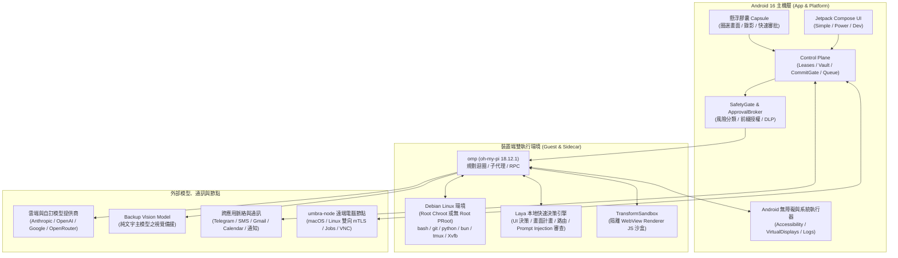

# Umbra 完整功能與系統規格總覽 (Complete Features Reference)

**Umbra** 是一款運行於 **Android 16 (API 36)** 裝置上的全功能自主 AI 代理與行動開發環境（Autonomous On-Device Agent & Pocket Linux Studio）。它結合了 **Android 螢幕無障礙操控**、**背景虛擬顯示器**、**內建真實 Debian Linux 環境**、**基於 `omp` (oh-my-pi) 的編碼與規劃迴圈**、**本地 Laya 快速決策與安全審查引擎**、**長期記憶與主動式個人助理（Proactive Assistants）**，以及**跨裝置分散式電腦節點（`umbra-node`）**，同時透過嚴格的審批閘門、輸入租約（Input Leases）與安全憑證交接機制，確保使用者始終掌握最高控制權。

---

## 目錄

1. [系統架構與核心引擎](#1-系統架構與核心引擎)
2. [介面模式、視覺主題與無障礙體驗](#2-介面模式視覺主題與無障礙體驗)
3. [個人助理與主動式代理系統 (Personal Assistants & Proactive Agents)](#3-個人助理與主動式代理系統-personal-assistants--proactive-agents)
4. [多代理團隊協作、示範教學與技能演化 (Teams, Teach Mode & Skills)](#4-多代理團隊協作示範教學與技能演化-teams-teach-mode--skills)
5. [跨應用個人脈絡與通訊連接器 (Cross-App Context & Connectors)](#5-跨應用個人脈絡與通訊連接器-cross-app-context--connectors)
6. [Telegram 遠端互動與雙向控制](#6-telegram-遠端互動與雙向控制)
7. [Coding Sessions 與手機端 Linux 開發環境](#7-coding-sessions-與手機端-linux-開發環境)
8. [工作階段檔案、資料夾掛載與 Git 保護檢查點](#8-工作階段檔案資料夾掛載與-git-保護檢查點)
9. [Android 手機操控、背景虛擬螢幕與視覺理解](#9-android-手機操控背景虛擬螢幕與視覺理解)
10. [懸浮膠囊 (Floating Capsule)、圈選畫面與螢幕錄影](#10-懸浮膠囊-floating-capsule圈選畫面與螢幕錄影)
11. [分散式電腦節點 (`umbra-node` / Distributed Nodes)](#11-分散式電腦節點-umbra-node--distributed-nodes)
12. [安全防線、審批機制、憑證交接與緊急控制](#12-安全防線審批機制憑證交接與緊急控制)
13. [Power Studio 專業控制面與系統治理](#13-power-studio-專業控制面與系統治理)
14. [AI 帳號、模型目錄、預算配額與自動更新](#14-ai-帳號模型目錄預算配額與自動更新)
15. [完整代理工具集總表 (Agent Tools Reference)](#15-完整代理工具集總表-agent-tools-reference)
16. [App 頁面路由與三模式導覽對照表](#16-app-頁面路由與三模式導覽對照表)

---

## 1. 系統架構與核心引擎

### 1.1 雙層 AI 決策架構
* **主規劃與編碼模型（Main Model）**：
  * 底層採用鎖定版本的 [`omp`](file:///Users/chengmatt/projects/umbra/runtime/omp/src/main/kotlin/app/umbra/runtime/omp)（`oh-my-pi` 18.12.1），透過 JSON-RPC 雙向串流管理長時程對話、工具呼叫、Todo 階段規劃與 Crash 自動重連（[`AgentSession.kt`](file:///Users/chengmatt/projects/umbra/core/orchestrator/src/main/kotlin/app/umbra/core/orchestrator/AgentSession.kt)）。
  * 支援針對不同任務或助理獨立指定模型與思考強度（`Effort`：`auto`、`minimal`、`low`、`medium`、`high`、`xhigh`、`max`）。
* **備援視覺模型（Backup Vision Model）**：
  * 當使用者選擇不具備圖片理解能力的純文字主模型時，系統可自動切換至設定的備援視覺模型（[`BackupVision.kt`](file:///Users/chengmatt/projects/umbra/core/orchestrator/src/main/kotlin/app/umbra/core/orchestrator/BackupVision.kt)）進行無工具（tool-free）視覺截圖分析，並共同計入該任務的費用預算。
* **Laya 本地快速決策與安全引擎（Fast Decision Engine）**：
  * 位於 [`core/decision`](file:///Users/chengmatt/projects/umbra/core/decision/src/main/kotlin/app/umbra/core/decision) 與 [`LayaSidecar.kt`](file:///Users/chengmatt/projects/umbra/app/src/main/kotlin/app/umbra/agent/data/LayaSidecar.kt)，在手機本地 Linux 環境內運行輕量模型服務（搭配私密 API Key 驗證身分），並具備規則啟發式引擎（[`HeuristicDecisionEngine.kt`](file:///Users/chengmatt/projects/umbra/core/decision/src/main/kotlin/app/umbra/core/decision/HeuristicDecisionEngine.kt)）作為回退機制。
  * **支援常駐預熱（Keep Laya Resident）**：可於任務間保持背景常駐，每 30 秒進行健康檢查，異常退出時具備指數退避重啟（最長 5 分鐘）。
  * **五大核心職責**：
    1. `decide` 工具：毫秒級回答二選一或多選一的畫面操作判斷。
    2. `android_run_plan`：在本地自主執行「觀察 → 選擇動作 → 審批執行 → 驗證」的多步語義畫面控制迴圈。
    3. **獨立安全與 Prompt Injection 審查**（[`ActionSecurityCheck.kt`](file:///Users/chengmatt/projects/umbra/core/safety/src/main/kotlin/app/umbra/core/safety/ActionSecurityCheck.kt)）：在動作執行前審查最近的工具輸出與畫面文字是否含有 Prompt Injection。
    4. **多助理訊息路由仲裁**（[`AgentDeliveryRouter.kt`](file:///Users/chengmatt/projects/umbra/app/src/main/kotlin/app/umbra/agent/agents/AgentDeliveryRouter.kt)）：判斷新進通知或訊息與哪些訂閱助理相關。
    5. **合成工具原始碼審查與 Watcher 語義條件判斷**。

### 1.2 特權梯度與執行拓撲
* **Root 與無 Root 雙模式支援**：
  * **Root 模式（Magisk / KernelSU）**：透過 [`RootChrootRuntime.kt`](file:///Users/chengmatt/projects/umbra/runtime/linux/src/main/kotlin/app/umbra/runtime/linux/RootChrootRuntime.kt) 在獨立 `chroot` 中執行 Debian 環境，將系統目錄設為唯讀、卸除 Linux Capabilities，並隔離 App 私有資料目錄（見 [ADR 0010](file:///Users/chengmatt/projects/umbra/docs/adr/0010-what-the-agent-can-reach.md)）。
  * **無 Root 模式（Rootless PRoot）**：透過 [`proot`](file:///Users/chengmatt/projects/umbra/docs/adr/0012-proot-without-root.md) 在一般未改機的 Android 16 手機上直接運行完整 Debian Linux 環境。
* **特權輔助服務（Privileged Helper）**：
  * 位於 [`HelperController.kt`](file:///Users/chengmatt/projects/umbra/app/src/main/kotlin/app/umbra/agent/HelperController.kt) 與 [`platform/server`](file:///Users/chengmatt/projects/umbra/platform/server/src/main/kotlin/app/umbra/platform/server)，可透過 **Root**、**Shizuku**（[`ShizukuLauncher.kt`](file:///Users/chengmatt/projects/umbra/app/src/main/kotlin/app/umbra/agent/ShizukuLauncher.kt)）或每次開機透過 **ADB** 啟動，提供背景虛擬顯示器建立、套件安裝與系統級診斷能力。Helper Token 透過環境變數安全傳遞，不暴露於命令列參數。

---

## 2. 介面模式、視覺主題與無障礙體驗

### 2.1 三種操作模式（UI Modes）
使用者可隨時於 **Settings（設定）** 切換三種介面複雜度（[`UiState.kt`](file:///Users/chengmatt/projects/umbra/app/src/main/kotlin/app/umbra/agent/data/UiState.kt)、[`PorcelainApp.kt`](file:///Users/chengmatt/projects/umbra/app/src/main/kotlin/app/umbra/agent/ui/shell/PorcelainApp.kt)）：
1. **Simple（簡易模式）**：專注於日常對話、個人助理與一鍵啟動 Coding 任務。隱藏終端機分頁、技術性標題列與控制面儀表板（仍可於 `Settings → More settings` 存取 Linux 設定、工作區、行程、顯示器與診斷）。
2. **Power（進階模式 / Power Studio）**：開放完整工作區瀏覽、多螢幕管理、分散式節點、Safety Hub，以及 Coding Session 的 `Activity`、`Terminal`、`Changes` 分頁與懸浮膠囊多任務切換列。
3. **Dev（開發者模式）**：開放 **Developer Hub**（包含 Product、Ops、Trust、System 四大分組共 20+ 個專業控制面與底層狀態監控頁面）。

### 2.2 四大視覺主題與動態設計（Design System）
位於 [`app/src/main/kotlin/app/umbra/agent/ui/porcelain`](file:///Users/chengmatt/projects/umbra/app/src/main/kotlin/app/umbra/agent/ui/porcelain)：
* **Ink（水墨黑白，0.5.0 預設主題，[`Ink.kt`](file:///Users/chengmatt/projects/umbra/app/src/main/kotlin/app/umbra/agent/ui/porcelain/Ink.kt)）**：高對比黑白極簡設計（淺色模式為近白紙張配純黑水墨按鈕；深色模式為純黑背景配炭灰卡片），色彩僅用於表達狀態語義（錯誤、需要注意、完成），搭配共享水平軸彈簧轉場動畫。
* **Porcelain（溫潤瓷器，[`Porcelain.kt`](file:///Users/chengmatt/projects/umbra/app/src/main/kotlin/app/umbra/agent/ui/porcelain/Porcelain.kt)）**：柔和米白與暖灰調性，提供自訂強調色（Accent colors）。
* **Liquid（液態玻璃，[`Liquid.kt`](file:///Users/chengmatt/projects/umbra/app/src/main/kotlin/app/umbra/agent/ui/porcelain/Liquid.kt) / [`Glass.kt`](file:///Users/chengmatt/projects/umbra/app/src/main/kotlin/app/umbra/agent/ui/porcelain/Glass.kt)）**：即時錄製背景圖層進行光學折射、模糊與液態按壓回彈效果（`LiquidLightSource`）。
* **Apple（iOS 風格，[`Theme.kt`](file:///Users/chengmatt/projects/umbra/app/src/main/kotlin/app/umbra/agent/ui/porcelain/Theme.kt)）**：採用襯線大標題、臨界阻尼彈簧頁面推入動畫（`UINavigationController` 曲線）與滾動邊緣漸隱溶解效果（`scrollEdge`）。

### 2.3 思考光球（Thinking Orbs）、單手模式與在地化
* **原生 Thinking Orbs 動畫**（[`ThinkingOrb.kt`](file:///Users/chengmatt/projects/umbra/app/src/main/kotlin/app/umbra/agent/ui/porcelain/ThinkingOrb.kt)、[`ThinkingOrbState.kt`](file:///Users/chengmatt/projects/umbra/app/src/main/kotlin/app/umbra/agent/ui/porcelain/ThinkingOrbState.kt)）：根據代理即時狀態（思考中、檢視中、撰寫中、連線中、委派執行中）呈現不同幾何與物理律動；聊天室顯示大型光球，標題列與列表顯示精簡指示器；當畫面離屏、進入背景或開啟「降低動態效果（Reduce Motion）」時自動停止動畫以節省電力。
* **左右手單手操作（Left / Right-handed Layout）**：可將懸浮選單（FAB Menu）與主要操作按鈕鏡像切換至左拇指或右拇指熱區（[`FabMenu.kt`](file:///Users/chengmatt/projects/umbra/app/src/main/kotlin/app/umbra/agent/ui/shell/FabMenu.kt)）。
* **完整雙語介面（English & 繁體中文）**：所有畫面、審批提示、法規條款與主動式助理介面皆提供完整英文（`values/`）與繁體中文（`values-zh-rTW/`），支援跟隨系統語言或於 Android 個別應用程式語言設定中指定。

---

## 3. 個人助理與主動式代理系統 (Personal Assistants & Proactive Agents)

Umbra 支援建立多個常駐於手機上的個人助理（[`Agents.kt`](file:///Users/chengmatt/projects/umbra/app/src/main/kotlin/app/umbra/agent/agents/Agents.kt)、[`AgentRuntime.kt`](file:///Users/chengmatt/projects/umbra/app/src/main/kotlin/app/umbra/agent/agents/AgentRuntime.kt)、[`ProactiveRuntime.kt`](file:///Users/chengmatt/projects/umbra/app/src/main/kotlin/app/umbra/agent/agents/proactive/ProactiveRuntime.kt)）：

### 3.1 助理設定檔、靈魂 (`SOUL.md`) 與範本交換
* **獨立身分與角色範本**：每個助理擁有獨立名稱、頭像/字母縮寫頭像、角色範本（[`AgentTemplates.kt`](file:///Users/chengmatt/projects/umbra/app/src/main/kotlin/app/umbra/agent/agents/proactive/AgentTemplates.kt)）、專屬模型與思考強度，並可設為首頁與懸浮膠囊的預設助理。
* **靈魂指令 (`SOUL.md`)**：使用者可隨時在 UI 中直接檢視與編輯助理的核心行為準則與個性。
* **範本匯出與匯入 (`TemplateExchange.kt`)**：支援將助理角色、技能與設定打包匯出分享或匯入（匯入時絕不包含任何私人記憶、憑證或授權狀態）。

### 3.2 長期記憶系統 (`MEMORY.md` & Team Memory)
* 位於 [`Memory.kt`](file:///Users/chengmatt/projects/umbra/app/src/main/kotlin/app/umbra/agent/agents/Memory.kt) 與 [`AgentPages.kt`](file:///Users/chengmatt/projects/umbra/app/src/main/kotlin/app/umbra/agent/ui/agents/AgentPages.kt)：
* **結構化記憶管理**：記錄使用者偏好、重要人物、生活習慣與承諾，包含日期、來源（如 `user`、`WhatsApp`、`#session`）、分類（`MemoryCategory`）、檢索標籤（Tags）與選用的到期時間（`expiresAtMs`）。
* **私有與團隊共享記憶**：助理在唯讀探索模式下僅能寫入私有記憶；在授權執行回合中可選擇將記憶標記為 `shared=true` 寫入團隊共享記憶（`teamMemory`）。
* **使用者完全可控**：支援在 UI 搜尋記憶、新增/修改/刪除單筆記憶、直接編輯完整 `MEMORY.md`，或**依日期區間批次遺忘記憶**。所有寫入均經過 `OutboundDlpGuard` 檢查，禁止存入密碼或驗證碼。

### 3.3 背景喚醒迴圈、計時器、觸發規則與省電保護
* **智慧背景喚醒（Wake Loop）**：
  * 支援定時心跳喚醒（Simple 模式預設 10 分鐘，Power 模式可自訂間隔）、計時器到期喚醒、規則命中即時喚醒與新訊息喚醒。
  * 每次喚醒注入精簡的 `[Wake · time · reason]` 摘要（不會顯示在聊天紀錄干擾使用者）；若無須通知使用者，助理以 `<QUIET>` 結束回合，不發送多餘的「任務完成」通知。
* **內建時間與排程工具**：
  * **計時器 (`AgentTimer`)**：支援指定時間（`18:00` 或 ISO 日期）、倒數分鐘（`in_minutes`）或 5 欄重複 Cron 表達式（`cron`）。
  * **即時規則 (`AgentRule`)**：設定「當來源 X 的訊息或通知包含文字 Y 時，立即執行 Z」。
  * **待辦佇列 (`QueueItem`)**：管理不緊急但需在背景空檔處理的事項。
* **電池與熱保護（Wake & Battery Controls）**：
  * 顯示今日喚醒次數、實際執行次數與預估電池消耗百分比。
  * 支援**手機過熱時自動放慢背景檢查**、**低電量時自動暫停背景喚醒**、以及**安靜時段（Quiet Hours）**設定。

### 3.4 主動式代理核心功能（Proactive Roadmap A1–A8）
位於 [`app/src/main/kotlin/app/umbra/agent/agents/proactive`](file:///Users/chengmatt/projects/umbra/app/src/main/kotlin/app/umbra/agent/agents/proactive) 與 [`ProactiveScreen.kt`](file:///Users/chengmatt/projects/umbra/app/src/main/kotlin/app/umbra/agent/ui/agents/ProactiveScreen.kt)：

| 編號 | 功能模組 | 實作細節與安全邊界 |
| :--- | :--- | :--- |
| **A1** | **持續性目標 (Persistent Goals)** | 支援建立含多個有序里程碑（`GoalMilestone`）、相依關係（`depends_on`）、驗收標準（`acceptanceCriteria`）、截止時間（`deadlineMs`）與 Cron 檢查週期的長期目標（[`GoalSchedule.kt`](file:///Users/chengmatt/projects/umbra/app/src/main/kotlin/app/umbra/agent/agents/proactive/GoalSchedule.kt)）。里程碑必須綁定經主機驗證的 Session 完成證據（[`GoalEvidence.kt`](file:///Users/chengmatt/projects/umbra/app/src/main/kotlin/app/umbra/agent/agents/proactive/GoalEvidence.kt)）才能標記為完成；支援按截止日優先順序自動派發 L4 執行任務。 |
| **A2** | **機會探索卡片 (Opportunity Discovery)** | 背景研究一律在不可變的**唯讀探索模式（`READ_ONLY_DISCOVERY`）**下進行，無法執行任何外部寫入或開啟終端機。發現的建議會產生具證據引用的 `OpportunityCard`（含緊急度、信心度、到期時間），使用者可在 App、懸浮膠囊或 Telegram 檢視、編輯內容後明確點擊「採納（Adopt）」才會啟動授權任務。 |
| **A3** | **低成本條件監看器 (Event Watchers)** | 支援三種本地探針（[`Watchers.kt`](file:///Users/chengmatt/projects/umbra/app/src/main/kotlin/app/umbra/agent/agents/proactive/Watchers.kt)）： 1. `HttpOrCss`（網頁 URL 與 CSS/JSON 選擇器） 2. `GuestCheckCommand`（受白名單限制的 Linux 唯讀檢查指令） 3. `NotificationPattern`（基於 Google RE2/J 的無回溯通知正規表示式匹配，單次最多檢查 200 筆、每筆 8,000 字元） 搭配 `changed`、`contains`、`numeric` 或本地 `laya` 語義判斷。**未命中時完全不呼叫雲端大模型**；必須由使用者審查來源並啟用（[`WatcherAuthority.kt`](file:///Users/chengmatt/projects/umbra/app/src/main/kotlin/app/umbra/agent/agents/proactive/WatcherAuthority.kt)）。 |
| **A4** | **常駐例行程序 (Time & Event Routines)** | 結合 Cron 時區排程、事件匹配或 Watcher 觸發的常駐自動化流程（[`RoutineDefinitions.kt`](file:///Users/chengmatt/projects/umbra/app/src/main/kotlin/app/umbra/agent/agents/proactive/RoutineDefinitions.kt)）。每組 Routine 綁定明確的連接器授權範圍（`allowedConnectors`）、審批有效時間（`approvalTTLMinutes`）與最小觸發間隔（冪等保護），保留最近 20 筆執行紀錄（最多 50 組 Routine）。 |
| **A5** | **動態重規劃 (Goal Replanning)** | 當外部條件改變或步驟失敗時，透過 `goal_replan` 更新未完成的里程碑，**強制保留已完成的里程碑與既有驗證證據**，並將重規劃原因寫入 `replanHistory`，同時取消舊的進行中子任務、要求重新確認授權。 |
| **A6** | **五階層注意力與防打擾 (Attention & Immersive Detection)** | [`Attention.kt`](file:///Users/chengmatt/projects/umbra/app/src/main/kotlin/app/umbra/agent/agents/proactive/Attention.kt) 與 [`ImmersiveApps.kt`](file:///Users/chengmatt/projects/umbra/app/src/main/kotlin/app/umbra/agent/agents/proactive/ImmersiveApps.kt) 綜合評估緊急度、信心度與使用者當前狀態（安靜時段、通話中、音訊播放、行事曆會議中、剛打完字、或正在全螢幕玩遊戲 `CATEGORY_GAME` / 看影片 `CATEGORY_VIDEO`），將訊息分流至 **Tier 0（丟棄/記錄）**、**Tier 1（排入早晚簡報）**、**Tier 2（靜默徽章/膠囊建議）**、**Tier 3（一般通知）** 或 **Tier 4（緊急提醒）**。 |
| **A7** | **早晚簡報 (Morning & Evening Briefs)** | 本地自動彙整當日行事曆行程、時間衝突提醒、會前背景準備研究與 `brief_stage` 暫存的低干擾事項，於早晚時段集中呈現。 |
| **A8** | **預備下一步 (Prepared Next Steps)** | 建議卡片可附帶結構化的預備動作（`start_coding`、`send_message_draft`、`create_goal`、`run_skill`、`agent_turn`），經使用者一鍵確認後直接轉為可見任務並防止重複觸發。 |

---

## 4. 多代理團隊協作、示範教學與技能演化 (Teams, Teach Mode & Skills)

### 4.1 多代理群組討論與專家委派 (`Teams.kt` / `TeamPanel.kt`)
* **多代理群組（Agent Groups）**：
  * 使用者可將多個不同專長的助理組成團隊並指定一位**協調者（Coordinator）**。
  * 發起群組討論時，支援以 `@名稱` 點名成員，或由 Laya 自動挑選最多 2 位最相關的成員回應。
  * **主機強制 4 跳上限（4 Host-Counted Hops）**：成員間可透過 `group_send` 請求下一棒成員補充，但主機嚴格限制最多 4 跳，最後一跳強制交由協調者彙整各方意見、未決問題與證據並將發言權交還使用者，絕不發生無限對話迴圈。
* **結構化專家委派（Structured Handoffs）**：
  * 助理可透過 `handoff_delegate` 將特定目標里程碑或子任務委派給另一位助理，自動繼承父任務的 AI 費用預算、連接器範圍與審批 TTL（預設 10 分鐘），同樣受最多 4 跳限制。
  * 受託助理透過 `handoff_complete` 回報時，主機會先檢查其獨立完成證據（`CompletionEvidence`），通過後才自動推進目標里程碑並通知原委派助理。

### 4.2 示範教學模式（Teach Mode / `Demonstrations.kt` & `TeachPanel.kt`）
* **真人操作錄製轉技能**：
  * 使用者可從助理的 **Skills / Teach** 分頁或懸浮膠囊啟動「示範教學（Teach Mode）」，在手機上親自操作一遍流程（最長 10 分鐘，最多 1,000 個步驟）。
  * **嚴格隱私遮罩**：錄製期間自動透過無障礙服務捕捉結構化元件互動（點擊、捲動、欄位焦點），**不錄製原始連續影片、不記錄鍵盤按鍵事件、所有輸入文字皆轉為參數佔位符，密碼欄位自動標記為 `[SECRET_INPUT_HANDOFF]`**，且僅在畫面無任何可編輯表單、無密碼欄、無敏感文字時才截取最多 60 張縮小版關鍵影格（Keyframes）。
  * 錄製完成後可一鍵萃取為參數化的 `UmbraSkill` 草稿，或供助理以 `demonstration_read` 讀取學習。

### 4.3 工作流技能與純資料合成工具 (`SkillStore.kt` & `SynthesizedTools.kt`)
* **可重用工作流技能（Workflow Skills）**：
  * 代理可從已驗證成功的任務中透過 `skill_extract_from_session` 萃取技能草稿（包含 `SKILL.md` 步驟說明、參數定義、審批邊界、必備驗證檢查與冪等規則），或透過 `skill_propose_patch` 提議修正既有技能。
  * **強制測試與版本綁定核准**：任何新草稿或修訂版都處於 `DRAFT` 狀態，必須先在真實測試任務（`SkillWorkflows.test`）中通過主機驗證（`testedVersion == version`），再由使用者於 UI 明確點擊啟用（`approvedVersion == version`）後，才能被 Routine 或助理呼叫。
* **隔離沙盒合成工具（Synthesized JSON Transform Tools）**：
  * 代理可透過 `tool_synthesize` 撰寫 2,200 字元以內的純 JSON-to-JSON JavaScript 轉換函式，並附上 1–10 組輸入/輸出測試案例。
  * **三重安全把關**：
    1. 靜態語法與 DLP 掃描（禁用 `eval`、`Function`、`fetch`、`XMLHttpRequest`、`WebSocket`、`import`、`process`、`window`、`document`、`localStorage` 等一切外部能力）。
    2. `skill_test` 交由本地 **Laya 進行完整原始碼安全審查**（信心度需 ≥ 0.9 且確認為純資料轉換），並記錄原始碼 SHA-256。
    3. 在 Android 獨立隔離的無權限 WebView Renderer 沙盒進程（[`TransformSandbox.kt`](file:///Users/chengmatt/projects/umbra/app/src/main/kotlin/app/umbra/agent/agents/proactive/TransformSandbox.kt)，獨立 UID、無網路、無檔案系統、無 JNI Bridge、嚴格執行逾時限制）中跑完所有測試案例，最後經使用者啟用後才開放 `tool_run` 呼叫。

---

## 5. 跨應用個人脈絡與通訊連接器 (Cross-App Context & Connectors)

### 5.1 統一脈絡檢索 (`PersonalContext.kt` / `context_resolve`)
* 每個助理僅能檢索使用者明確授權給該助理的資料來源（`memory`、`messages`、`notifications`、`email`、`calendar`、`contacts`、`tasks`、`documents`）。
* 檢索結果皆附帶明確來源、時間戳與摘錄（`ContextEvidence`），並強制標示外部內容為不可信資料（Untrusted Evidence），不作為指令執行。

### 5.2 訊息與社群應用連接器 (`Connectors.kt` & `Messages.kt`)
支援 **9 大通訊管道**：**SMS 簡訊、WhatsApp、LINE、Telegram、Messenger、Instagram、Snapchat、X (Twitter)、iMessage (透過 BlueBubbles / OpenBubbles)**。
* **多元連接方式**：
  * **Android 通知整合（Notifications）**：讀取保留的通知訊息，並透過通知內建的 Direct Reply Action 直接回覆。
  * **系統 SMS（System SMS）**：透過 Android `READ_SMS` / `SEND_SMS` 權限讀寫簡訊，並即時監聽新進簡訊喚醒訂閱助理（含驗證碼的簡訊會被自動過濾排除）。
  * **BlueBubbles / OpenBubbles API**：連接自建 HTTPS 伺服器與密碼收發 iMessage。
  * **X API**：使用配置的 User Token 讀取與發送貼文（發送一律需審批）。
  * **背景視覺工具**：透過 Android 螢幕工具在背景操作 App（當使用者正在前景使用該通訊 App 或剛離開 5 秒內，背景操作會自動禮讓暫停）。
* **細粒度回覆權限控制（`MessageSendPolicy`）**：
  * 可針對單一已知的一對一聊天對象開啟「允許自動回覆（Auto-reply）」；**所有群組聊天（Group chats）與未授權對象一律強制彈出審批確認**。
  * 發送失敗或狀態不明時絕不自動切換管道重試，防止重複發送訊息。

### 5.3 通知讀取器與加密保存 (`NotificationReader.kt` & `NotificationPrivacy.kt`)
* **三級 App 策略**：可針對手機上每個 App 設定 **Use（允許助理讀取與觸發）**、**Context（僅供被動查詢脈絡）** 或 **Ignore（完全忽略並立即清除該 App 已存紀錄）**。
* **預設隱私防護**：
  * 預設自動將銀行、支付、金融與雙重驗證器（Authenticator）App 設為忽略。
  * 預設自動忽略含有一次性驗證碼（OTP / 2FA code）的通知；若使用者手動開啟保留，亦會在寫入前自動將驗證碼遮罩為 `[REDACTED_CODE]`。
* **硬體金鑰加密與保存期限**：保留的通知內容使用 Android Keystore 對稱金鑰加密儲存於本機，支援 **1 天、7 天（預設）或 30 天** 自動過期清理，並提供一鍵遺忘功能。

### 5.4 Gmail、行事曆、聯絡人、本機待辦與安全文件夾
* **Gmail 整合 (`GmailContextApi.kt`)**：
  * OAuth Token 儲存在原生加密區，絕不暴露給模型或 Linux 環境。
  * 支援 `email_read`（搜尋郵件）、`email_draft`（建立單一收件人草稿）與 `email_send`（需 `SEND_WITH_APPROVAL` 授權並通過 `SafetyGate` 審批，同一使用者回合內具備防重複寄送保護）。
* **Android 行事曆整合 (`CalendarDraft.kt` & `PersonalContext.kt`)**：
  * `calendars_list` 與 `calendar_read`：讀取未來行程與可寫入的行事曆清單。
  * `calendar_write`：建立行程草稿供使用者檢視，或在具備 `WRITE_EVENTS` 權限與審批下直接寫入行事曆。
  * `calendar_update` 與 `calendar_delete`（0.5.0 新增）：經使用者審批（完整對比修改前與修改後欄位）並驗證事件未被外部修改後，可更新或刪除**單一、非重複且無其他受邀賓客**的行程；週期性重複行程與有其他與會者的會議強制保留給使用者親自修改。
* **聯絡人與本機待辦**：
  * `contacts_read`：依授權查詢通訊錄姓名與電子郵件。
  * `tasks_read` / `tasks_write`：管理助理專屬的本機待辦事項清單。
* **授權本機文件資料夾 (`DocumentContext.kt` & `DocumentSearch.kt`)**：
  * 使用者透過 Android 系統資料夾選擇器（SAF Picker）針對個別助理授權唯讀資料夾。
  * 僅在查詢時即時讀取 UTF-8 純文字與程式碼/Markdown/JSON/CSV 檔案（自動略過二進位檔與符號連結，限制最多走訪 8 層目錄、500 個檔案、單檔 ≤ 512 KB、總讀取 ≤ 4 MB），回傳有限長度的段落摘錄，不在背景建立全文索引副本。

---

## 6. Telegram 遠端互動與雙向控制

位於 [`app/src/main/kotlin/app/umbra/agent/telegram`](file:///Users/chengmatt/projects/umbra/app/src/main/kotlin/app/umbra/agent/telegram) 與 [`TelegramScreen.kt`](file:///Users/chengmatt/projects/umbra/app/src/main/kotlin/app/umbra/agent/ui/agents/TelegramScreen.kt)：

* **私有 Bot 綁定**：使用者填入自己的 Telegram Bot Token，並透過一次性有效連結綁定單一 Telegram 帳號（僅接受該綁定 Chat ID 的私聊訊息）。
* **多模態訊息輸入**：
  * 支援傳送**文字、照片、相簿（Media Albums 自動合併為同一則多圖訊息）、檔案、影片、貼圖（自動轉為對應 Emoji）與語音訊息（透過 [`VoiceTranscriber.kt`](file:///Users/chengmatt/projects/umbra/app/src/main/kotlin/app/umbra/agent/telegram/VoiceTranscriber.kt) 自動轉成文字）**給指定的助理。
  * **Emoji Reactions 回饋（0.5.0 新增）**：使用者對 Bot 訊息按讚或表情符號反應時，會傳遞給助理解讀為回饋（助理僅在需要時才回覆，可於設定開關）。
* **遠端審批、主動建議卡片與交付檔案回傳**：
  * 當任務需要審批時，Telegram 會收到完整審批訊息與內嵌按鈕（Approve once / Permanent prefix 二次確認 / Deny）。
  * 主動探索產生的 `OpportunityCard` 可發送至 Telegram（[`OpportunityReviews.kt`](file:///Users/chengmatt/projects/umbra/app/src/main/kotlin/app/umbra/agent/telegram/OpportunityReviews.kt)），按鈕綁定原始私聊與完整證據，需先點擊檢視細節後才能確認採納，10 分鐘後或重啟時自動失效。
  * **自動回傳交付檔案（0.5.0 新增）**：由 Telegram 發起的請求，若完成時透過 `deliverable_publish` 發佈了工作區成果檔案，系統會在重新驗證 SHA-256 無誤後，自動將檔案（單檔 ≤ 50 MB，最多 10 個）直接以 Telegram Document 傳回給使用者。
* **Bot 控制指令與智慧路由**：
  * `/status`（查看目前工作狀態）、`/stop`（立即停止當前助理任務）、`/agents`（切換對話目標助理）。
  * **通道黏著性（Channel Affinity）**：從 Telegram 發起的對話，其後續回覆、計時提醒與審批通知都會維持發送到 Telegram，直到使用者主動在手機 App 內發送新訊息為止（[`AgentReplyPolicy.kt`](file:///Users/chengmatt/projects/umbra/app/src/main/kotlin/app/umbra/agent/agents/AgentReplyPolicy.kt)）。

---

## 7. Coding Sessions 與手機端 Linux 開發環境

### 7.1 完整 Debian Linux 執行環境 (`runtime/linux` & `guest/`)
* **APK 內建離線安裝包**：Release APK 內含由 `runtime-build/rootfs/build.sh` 建置的 Debian 環境壓縮檔（[ADR 0011](file:///Users/chengmatt/projects/umbra/docs/adr/0011-linux-inside-the-apk.md)），無需網路即可完成解壓縮與初始化；同時支援從本機檔案或自訂 HTTPS URL 安裝。
* **核心預裝工具**：`bash`、`git`、`python3`、`bun`、`tmux`、`curl`、`ripgrep` 以及鎖定版本的 `omp` 編碼代理執行檔。
* **六大模組化擴充套件包（Add-on Packs，位於 [`guest/packs`](file:///Users/chengmatt/projects/umbra/guest/packs)）**：
  可於 **Linux Setup (`SetupScreen.kt`)** 一鍵單獨安裝或全部安裝：
  1. **Development Tools (`dev.apt`)**：`build-essential`、`clang`、`cmake`、`make`、`pkg-config`、`gdb` 等 C/C++ 原生編譯工具。
  2. **Node.js (`node.apt`)**：Node.js 與 npm 開發環境。
  3. **Java (`java.apt`)**：OpenJDK 工具鏈。
  4. **Android Build Tools (`android.apt` + `android.post`)**：在手機上直接編譯、打包與簽署 Android APK（支援完整的「在手機上寫 Code → 編譯 APK → 安裝到手機 → 抓取 Logcat Crash → 修復重編」自主開發迴圈）。
  5. **Desktop Environment (`gui.apt` + `umbra-gui`)**：安裝 Xvfb 虛擬 X11 顯示器、Openbox 視窗管理員與 AT-SPI 無障礙服務，啟用 `gui_*` 桌面操控工具。
  6. **Browser (`browser.apt`)**：安裝桌面級瀏覽器供 DOM 自動化與視覺瀏覽使用。

### 7.2 Coding Session 介面與生命周期 (`CurrentScreen.kt` & `AgentSession.kt`)
* **四大檢視模式（Power / Dev 模式）**：
  * **Chat**：對話氣泡、Markdown 渲染（[`Markdown.kt`](file:///Users/chengmatt/projects/umbra/app/src/main/kotlin/app/umbra/agent/ui/Markdown.kt)）、工具執行折疊摘要、審批卡片、提問回答卡片（[`QuestionBroker.kt`](file:///Users/chengmatt/projects/umbra/core/orchestrator/src/main/kotlin/app/umbra/core/orchestrator/QuestionBroker.kt)）、以及交付物收據卡片（[`DeliverableCard.kt`](file:///Users/chengmatt/projects/umbra/app/src/main/kotlin/app/umbra/agent/ui/current/DeliverableCard.kt)）。
  * **Activity**：完整事件時間軸（[`Timeline.kt`](file:///Users/chengmatt/projects/umbra/app/src/main/kotlin/app/umbra/agent/ui/Timeline.kt)），包含每次工具呼叫、耗時、狀態與子代理事件。
  * **Terminal**：內嵌即時互動終端機（[`TerminalPane.kt`](file:///Users/chengmatt/projects/umbra/app/src/main/kotlin/app/umbra/agent/ui/terminal/TerminalPane.kt)），可直接檢視或接管 `omp` TUI（[`OmpTui.kt`](file:///Users/chengmatt/projects/umbra/core/orchestrator/src/main/kotlin/app/umbra/core/orchestrator/terminal/OmpTui.kt)）與 `tmux` Shell。
  * **Changes**：檢視工作區檔案變更與 Git Protection 檢查點歷史。
* **多工作階段協作與子代理（`SessionTools.kt`）**：
  * 任何 Session 均可透過 `#handle` 或 `@agent` 互相發訊（`session_send` / `session_reply`）或讀取摘要與分頁歷史（`session_read`）。
  * Coding Session 可啟動並行子代理（`subagent_start`），子代理共用同一工作目錄與權限，但可選用較輕量的模型處理機械性工作。
* **獨立驗證與交付物收據（`CompletionEvidence.kt` & `DeliverableTools.kt`）**：
  * 任務完成時自動儲存脫敏後的結果摘要（`ResultSummaries.kt`）。
  * 代理透過 `deliverable_publish` 發佈成果檔案時，系統會檢查檔案是否確實位於工作區內、計算 SHA-256 雜湊，並由主機根據最後一次修改後是否有成功的測試/驗證工具紀錄以及是否有未完成的子代理，獨立判定 `verified = true / false`。使用者點擊收據開啟或分享檔案時（[`DeliverableFiles.kt`](file:///Users/chengmatt/projects/umbra/app/src/main/kotlin/app/umbra/agent/data/DeliverableFiles.kt)），會再次核對 SHA-256 確保檔案未被竄改。

---

## 8. 工作階段檔案、資料夾掛載與 Git 保護檢查點

位於 [`SessionFiles.kt`](file:///Users/chengmatt/projects/umbra/app/src/main/kotlin/app/umbra/agent/data/SessionFiles.kt)、[`SessionFileButton.kt`](file:///Users/chengmatt/projects/umbra/app/src/main/kotlin/app/umbra/agent/ui/current/SessionFileButton.kt) 與 [`GitProtection.kt`](file:///Users/chengmatt/projects/umbra/core/workspace/src/main/kotlin/app/umbra/core/workspace/GitProtection.kt)：

* **靈活的檔案與資料夾連接（Paperclip 附件功能）**：
  * **連接單一裝置檔案**：在工作區建立指向原始檔案的捷徑，代理對檔案的編輯會直接反映在原始檔案上。
  * **掛載裝置資料夾（Mount Folder）**：將手機上的既有專案資料夾直接掛載為該 Session 的工作目錄。
  * **雲端檔案匯入**：來自雲端硬碟（SAF 虛擬文件）的檔案會安全匯入為工作區副本。
  * **快速引用**：可一鍵將已連接檔案的路徑插入對話輸入框。
* **無侵入式 Git 保護檢查點（Git Protection，預設啟用）**：
  * 在每次任務開始前與每個回合結束後，系統自動為工作目錄建立**私有 Git 檢查點（Private Checkpoints）**。
  * **完整涵蓋且不污染原倉庫**：檢查點包含未追蹤檔案、未提交變更以及 `.gitignore` 忽略的檔案，且透過獨立的 Git 物件與索引機制運作，**完全不會改動專案原本的 `.git/index`（Staging Area）或當前分支 Commit**。
  * **安全還原與歷史保留**：使用者可隨時瀏覽各回合檢查點並還原至一個全新的管理工作區（不覆寫破壞原目錄）；中斷連接或重啟 App 後，原始檔案與檢查點歷史依然完整保留，且保護機制會自動延伸至委派的子 Coding Session。

---

## 9. Android 手機操控、背景虛擬螢幕與視覺理解

位於 [`platform/android`](file:///Users/chengmatt/projects/umbra/platform/android/src/main/kotlin/app/umbra/platform/android)、[`platform/vision`](file:///Users/chengmatt/projects/umbra/platform/vision/src/main/kotlin/app/umbra/platform/vision) 與 [`tools`](file:///Users/chengmatt/projects/umbra/tools/src/main/kotlin/app/umbra/tools)：

### 9.1 無障礙優先、視覺標記輔助的雙模操控
* **無障礙元件樹（Accessibility Tree First）**：
  * `android_observe` 擷取結構化視窗與元件樹，為每個可見元件分配穩定識別碼（如 `[101:0.3]`），支援依 `element` ID、`label` 文字、`contains` 片段、`resource_id` 或 `class_name` 精準定位，不受螢幕排版微調影響。
* **Set-of-Mark 視覺標記截圖（Visual Computer Use）**：
  * 當遇到遊戲、Canvas、自繪 UI 或無障礙樹缺失的畫面時，`android_screenshot(annotate=true)` 會在所有可互動區域繪製編號方框（Marks）或像素座標網格（`grid=true`），代理只需傳入 `mark=N` 即可點擊對應目標。
* **動作後自動驗證（Action Verification Pipeline）**：
  * [`Verifier.kt`](file:///Users/chengmatt/projects/umbra/tools/src/main/kotlin/app/umbra/tools/Verifier.kt) 支援在任何點擊、輸入、捲動或啟動 App 時附加 `expect` 條件（`text_visible`、`text_gone`、`element_visible`、`element_gone`、`package`、`activity`、`no_crash`、`log_regex`、`changed`），未達成時回報實際觀察到的畫面狀態。

### 9.2 背景虛擬顯示器（Background Virtual Displays）
* 透過 [`VirtualDisplays.kt`](file:///Users/chengmatt/projects/umbra/platform/server/src/main/kotlin/app/umbra/platform/server/VirtualDisplays.kt) 與 [`DisplayLeaseManager.kt`](file:///Users/chengmatt/projects/umbra/tools/src/main/kotlin/app/umbra/tools/DisplayLeaseManager.kt)，代理可呼叫 `android_display(action="create")` 建立獨立的虛擬顯示器（如 `display=2`），在背景開啟並操作目標 App，**完全不佔用使用者的手機主畫面（`display=0`）**。
* 使用者可在 Coding 對話頁頂部的 **Live Display Preview**（[`LiveDisplay.kt`](file:///Users/chengmatt/projects/umbra/app/src/main/kotlin/app/umbra/agent/ui/current/LiveDisplay.kt)）或 **Screens（螢幕管理，[`ScreensScreen.kt`](file:///Users/chengmatt/projects/umbra/app/src/main/kotlin/app/umbra/agent/ui/displays/ScreensScreen.kt)）** 即時觀看背景螢幕畫面、展開全螢幕檢視或隨時接管。任務結束時自動銷毀釋放虛擬螢幕。

### 9.3 即時日誌監控與崩潰偵測 (`LogMonitor` & `CrashDetector`)
* 位於 [`platform/logs`](file:///Users/chengmatt/projects/umbra/platform/logs/src/main/kotlin/app/umbra/platform/logs)：
* 支援透過 `android_logs` 查詢、正則過濾、持續監看（`watch`）與彙整 Logcat。
* 當手機上任何受監控 App 發生未處理例外（Crash）或無回應（ANR）時，`CrashDetector` 會自動擷取堆疊追蹤並注入代理工作階段，讓代理即時診斷並修復問題。

---

## 10. 懸浮膠囊 (Floating Capsule)、圈選畫面與螢幕錄影

位於 [`app/src/main/kotlin/app/umbra/agent/capsule`](file:///Users/chengmatt/projects/umbra/app/src/main/kotlin/app/umbra/agent/capsule)：

* **鏡頭錨定懸浮膠囊（Camera-Anchored Capsule）**：
  * 在任何其他 App 上方常駐極簡膠囊控制項，顯示進行中任務的標題、耗時、當前執行步驟（文字具滑動過渡動畫）、Todo 進度（Previous / Current / Next）與 Thinking Orb 狀態燈。
  * **智慧避讓其他膠囊 App（0.5.0 新增，[`CapsuleNeighbours.kt`](file:///Users/chengmatt/projects/umbra/app/src/main/kotlin/app/umbra/agent/capsule/CapsuleNeighbours.kt)）**：提供 **Auto**、**Around the camera**、**Top corner** 三種位置設定；在 Auto 模式下，若偵測到 Material Capsule 等同類鏡頭膠囊 App 正在運行，Umbra 會自動移至頂部角落，並在對方展開時自動淡出避讓。
  * **不跳出當前 App 即可操作**：支援直接在膠囊內輸入或語音聽寫新指令、與預設助理對話、一鍵核准/拒絕審批請求、回答代理提問、查看環境主動建議卡片（[`CapsuleSuggestions.kt`](file:///Users/chengmatt/projects/umbra/app/src/main/kotlin/app/umbra/agent/capsule/CapsuleSuggestions.kt)），以及在多任務間快速切換（[`Crew.kt`](file:///Users/chengmatt/projects/umbra/app/src/main/kotlin/app/umbra/agent/capsule/Crew.kt)）。
* **圈選畫面（Snapshot Selection / Lasso）**：
  * 點擊選單或膠囊的 **Select screen**，在當前任何 App 畫面上用手指畫圈（[`ScreenSelection.kt`](file:///Users/chengmatt/projects/umbra/core/model/src/main/kotlin/app/umbra/core/model/observation/ScreenSelection.kt)），系統即自動裁切該區域截圖並提取圈選範圍內的無障礙樹文字，作為附件隨指令一併送出（[ADR 0014](file:///Users/chengmatt/projects/umbra/docs/adr/0014-capsule-and-snapshot-selection.md)）。
* **螢幕錄影脈絡（Screen Recording Context）**：
  * 透過 [`ScreenRecorder.kt`](file:///Users/chengmatt/projects/umbra/app/src/main/kotlin/app/umbra/agent/capsule/ScreenRecorder.kt) 從膠囊啟動螢幕錄影（最長 3 分鐘，點擊膠囊即可停止），系統自動將錄影抽樣合成為帶時間戳的關鍵影格拼圖（Contact sheet）與畫面文字變化時間軸，讓模型精準理解連續動態操作。

---

## 11. 分散式電腦節點 (`umbra-node` / Distributed Nodes)

位於 [`core/nodes`](file:///Users/chengmatt/projects/umbra/core/nodes/src/main/kotlin/app/umbra/core/nodes)、[`node-runner`](file:///Users/chengmatt/projects/umbra/node-runner/src/main/kotlin/app/umbra/noderunner)、[`node-go`](file:///Users/chengmatt/projects/umbra/node-go) 與 [`app/src/main/kotlin/app/umbra/agent/ui/nodes`](file:///Users/chengmatt/projects/umbra/app/src/main/kotlin/app/umbra/agent/ui/nodes)（[ADR 0018](file:///Users/chengmatt/projects/umbra/docs/adr/0018-distributed-nodes.md)）：

* **跨平台桌面伴侶程式（macOS & Linux）**：
  * 提供含圖形安裝設定精靈的 `node-go`（支援 macOS Universal DMG、Linux amd64/arm64 AppImage 與 minisign 簽章驗證安裝腳本）及 JVM 版 `node-runner`。
* **雙向憑證綁定配對（Pinned Mutual TLS Pairing）**：
  * 支援透過手機相機掃描電腦端顯示的 **QR Code**（[`NodeQrCamera.kt`](file:///Users/chengmatt/projects/umbra/app/src/main/kotlin/app/umbra/agent/ui/nodes/NodeQrCamera.kt)、[`NodeQrDecoder.kt`](file:///Users/chengmatt/projects/umbra/app/src/main/kotlin/app/umbra/agent/ui/nodes/NodeQrDecoder.kt)，支援多方向旋轉解碼）或輸入一次性配對碼與位址配對。
  * 配對時雙方互相鎖定（Pin）對方的 TLS 憑證指紋，並需在電腦端確認；新配對節點預設不接收任何工作，直到使用者在手機上調升其信任等級（`UNTRUSTED` → `LIMITED` → `OWNED`）。
* **Manifest 與租約限制的遠端工作 (`node_job`)**：
  * 代理可在 `OWNED` 節點的專屬 jobs 目錄下執行指令，僅能讀取該工作 Manifest 明列授權的檔案，且每個工作皆有硬性租約期限（Lease），若手機斷線且租約到期，電腦端會自動終止該工作。
* **遠端電腦畫面串流、接管與電腦端 Coding CLI 操作 (`remote_screen` & `RemoteNodeViewer.kt`)**：
  * 透過雙向 mTLS 加密通道傳輸 RFB (VNC) 桌面畫面（macOS 支援原生螢幕擷取，Linux 支援私人 Unix Socket `Xvfb`/`x11vnc`）。
  * **三種互動層級**：
    1. **Watch（純觀看）**：手機端僅觀看電腦畫面，完全不發送任何滑鼠或鍵盤事件。
    2. **User Takeover（使用者親自接管）**：使用者在手機上開啟鍵盤與觸控板直接操作電腦螢幕（例如直接從手機 Coding 選單選擇 **Computer coding sessions**，連線查看並親手輸入指令操作電腦上正在運行的 **Claude Code、Codex 或 omp** 終端機）。
    3. **Agent Control（代理遠端操控）**：當雙端皆開啟代理螢幕權限且使用者未接管時，代理可透過 `remote_screen` 截圖並在每次輸入經使用者審批後傳送座標點擊、按鍵或文字。
* **節點撤銷與離線狀態誠實呈現（Node Revocation）**：
  * 使用者可隨時在手機端撤銷節點（或於電腦端以 `umbra-node phones` / `umbra-node unpair` 移除手機）；若撤銷時節點離線，UI 會誠實標示為 **「Revocation pending / Jobs not confirmed stopped」**，絕不偽造已停止的假象。

---

## 12. 安全防線、審批機制、憑證交接與緊急控制

位於 [`core/safety`](file:///Users/chengmatt/projects/umbra/core/safety/src/main/kotlin/app/umbra/core/safety) 與 [`core/control`](file:///Users/chengmatt/projects/umbra/core/control/src/main/kotlin/app/umbra/core/control)：

### 12.1 靜態規則 + Laya 獨立安全審查 (`SafetyGate.kt` & `ActionSecurityCheck.kt`)
* **多維度靜態風險分析**：
  * [`ShellRiskAnalyzer.kt`](file:///Users/chengmatt/projects/umbra/core/safety/src/main/kotlin/app/umbra/core/safety/ShellRiskAnalyzer.kt) 與 [`ShellLexer.kt`](file:///Users/chengmatt/projects/umbra/core/safety/src/main/kotlin/app/umbra/core/safety/ShellLexer.kt)：解析 Shell 指令語法、管線、重導向、環境變數與工作目錄；凡涉及 `input tap`、`cmd input`、`sendevent`、`monkey`、`uiautomator` 等螢幕注入指令一律視為螢幕控制風險並強制要求單次審批。
  * [`UiRiskAnalyzer.kt`](file:///Users/chengmatt/projects/umbra/core/safety/src/main/kotlin/app/umbra/core/safety/UiRiskAnalyzer.kt) 與 [`PathClassifier.kt`](file:///Users/chengmatt/projects/umbra/core/safety/src/main/kotlin/app/umbra/core/safety/PathClassifier.kt)：識別付款、傳訊、刪除、安裝、安全設定、密碼欄位與敏感檔案路徑。
* **Laya 獨立 Prompt Injection 審查（`LayaActionSecurityCheck`）**：
  * 在動作放行前，由本地 Laya 審查當前動作、畫面文字與最近工具輸出樣本。
  * **單向加嚴原則**：Laya 只能提高風險等級，絕不能移除或降低靜態規則判定；若 Laya 懷疑遭受 Prompt Injection，動作立即升級為 `CRITICAL`，即使在 Autonomous 模式或已有永久前綴授權下也強制要求使用者重新確認。
* **三種全域模式與四向自訂規則**：
  * 全域模式：**Cautious（謹慎）**、**Balanced（平衡）**、**Autonomous（自主）**。
  * 自訂規則（[`CustomActionRule.kt`](file:///Users/chengmatt/projects/umbra/core/safety/src/main/kotlin/app/umbra/core/safety/CustomActionRule.kt)）：可針對特定工具或類別設定 **Allow（允許）**、**Ask（詢問）**、**Takeover（強制由使用者接管）** 或 **Deny（拒絕）**。
  * **自我保護鐵律（[`ScreenGuard.kt`](file:///Users/chengmatt/projects/umbra/tools/src/main/kotlin/app/umbra/tools/ScreenGuard.kt)）**：代理在任何情況下皆被禁止操作 Umbra App 自身視窗或點擊自己的審批通知。

### 12.2 指令審批與字面量前綴授權 (`CommandPrefixes.kt`)
* 審批畫面完整顯示**指令全文、工作目錄 (`cwd`)、標準輸入 (`stdin`) 與環境變數名稱**。
* 使用者可選擇 **「核准一次（Approve once）」**，或針對安全的單一字面量指令透過**二次確認**授予 **「永久核准字面量前綴（Permanent literal prefix）」**（綁定該工作目錄、跨重啟持久化保存，並可於設定中隨時撤銷）。
* 含有複合 Shell 語法（`&&`, `||`, `;`, `|`, `$()`, `` ` ``）、直譯器單行腳本（`python -c`, `sh -c`, `node -e`）、螢幕輸入注入、Root 執行或 `CRITICAL` 等級的指令，系統強制禁止授予永久前綴。

### 12.3 原生安全憑證交接 (`CredentialHandoff.kt` / `CredentialHandoffActivity.kt`)
* **密碼絕不進聊天室與模型 Context**：
  * 當代理遇到登入表單時，透過 `request_credential_handoff` 產生 10 分鐘有效的一次性連結（支援經 Android App Links 驗證的 `https://umbra-agent.pages.dev/credential-handoff/#...` 或本機連結）與高優先通知，同時暫停代理並將螢幕控制權交給使用者。
  * 使用者在標記了 `FLAG_SECURE`（禁止截圖與錄影）的原生面板中檢視目標 App Package 與欄位資訊後親手輸入密碼。
  * 系統驗證目標視窗與表單結構未改變後，透過無障礙服務直接將值填入該欄位（最多一次），並將該敏感值加密存入 `credential-handoff-values` 供 `OutboundDlpGuard` 全域攔截遮罩；直到原欄位被清空或登入完成、畫面上不再顯示該敏感值後，才允許將控制權交還代理。

### 12.4 結帳保護 (`CheckoutGuard.kt`) 與外發 DLP (`OutboundDlpGuard.kt`)
* **結帳與付款保護**：偵測到購買、下單、轉帳或結帳操作時，強制升級為 `CRITICAL` 審批，明確列出完整交易細節與未知條款；涉及輸入信用卡號、密碼或 3DS/SCA 雙重驗證時，強制要求使用者親自接管（Takeover）。
* **全方位 DLP 防護**：
  * 模型輸入、工具回傳結果、記憶寫入、訊息/郵件發送與遠端節點指令均經過 [`OutboundDlpGuard.kt`](file:///Users/chengmatt/projects/umbra/core/safety/src/main/kotlin/app/umbra/core/safety/OutboundDlpGuard.kt) 與 [`ModelPayloadGuard.kt`](file:///Users/chengmatt/projects/umbra/core/safety/src/main/kotlin/app/umbra/core/safety/ModelPayloadGuard.kt) 檢查，防止已存 API Keys 或交接憑證外洩。
  * 傳遞給 Linux 指令與 `omp` 的 API 密鑰全面改由 **標準輸入（`stdin`）** 注入，不在 Linux 檔案系統留下任何暫存環境變數檔。

### 12.5 即時接管、緊急封鎖 (Emergency Lockdown) 與「停止並取回權限」
* **Input Leases（世代圍欄輸入租約，[`InputLeases.kt`](file:///Users/chengmatt/projects/umbra/core/control/src/main/kotlin/app/umbra/core/control/InputLeases.kt)）**：
  * 手機螢幕（`display:N`）、Linux 虛擬桌面（`gui:0`）、每個終端機與每個遠端節點皆由獨立的世代編號（Generation）租約保護。使用者一旦按下「Take Back / 接管」，所有進行中或排隊中的代理輸入在寫入點立即被拒絕（Fenced），且交還控制權後代理必須先重新觀察畫面才能動作。
* **Emergency Lockdown（[`EmergencyScreen.kt`](file:///Users/chengmatt/projects/umbra/app/src/main/kotlin/app/umbra/agent/ui/emergency/EmergencyScreen.kt)）**：
  * 每個頁面右上角皆有常駐的盾牌按鈕，可立即啟動全域緊急封鎖（Lockdown），凍結所有輸入租約與背景派發，狀態跨 App 重啟持續有效，直到使用者手動解除。
* **Stop and Take Back（[`SettingsScreen.kt`](file:///Users/chengmatt/projects/umbra/app/src/main/kotlin/app/umbra/agent/ui/SettingsScreen.kt) / [`StopAll.kt`](file:///Users/chengmatt/projects/umbra/app/src/main/kotlin/app/umbra/agent/ui/emergency/StopAll.kt)）**：
  * 提供四項明確告知影響範圍的一鍵收回控制功能：**Stop everything（停止所有任務與助理）**、**Revoke helpers（撤銷特權 Helper）**、**Turn screen control off（關閉無障礙螢幕控制）**、**Delete history（刪除所有對話與審批歷史）**。

---

## 13. Power Studio 專業控制面與系統治理

在 **Power** 與 **Dev** 模式下，Umbra 提供完整的系統級控制面（[`core/control`](file:///Users/chengmatt/projects/umbra/core/control/src/main/kotlin/app/umbra/core/control)）：

1. **Planning & Wait Graph（規劃與資源等待圖，[`PlanningScreen.kt`](file:///Users/chengmatt/projects/umbra/app/src/main/kotlin/app/umbra/agent/ui/planning/PlanningScreen.kt)）**：
   * 追蹤每個 Session 的計畫修訂版本（Plan Revisions）、各階段子任務進度，以及跨資源的等待相依圖（例如當使用者接管手機螢幕時，明確標示 UI 階段為 `Blocked on display:0`，而無關的編譯任務繼續執行）。
2. **Resource Manager & Admission Queue（資源治理與公平准入佇列，[`ResourceScreen.kt`](file:///Users/chengmatt/projects/umbra/app/src/main/kotlin/app/umbra/agent/ui/resources/ResourceScreen.kt)）**：
   * 即時採樣手機記憶體、CPU 與溫度狀態（[`AndroidResourceSampler.kt`](file:///Users/chengmatt/projects/umbra/app/src/main/kotlin/app/umbra/agent/data/AndroidResourceSampler.kt)、[`HysteresisThrottle.kt`](file:///Users/chengmatt/projects/umbra/core/perf/src/main/kotlin/app/umbra/core/perf/Throttle.kt)）。
   * 超過手機並行槽位上限的代理請求會進入公平且透明的 **Admission Queue**（[`AdmissionOrder.kt`](file:///Users/chengmatt/projects/umbra/core/orchestrator/src/main/kotlin/app/umbra/core/orchestrator/AdmissionOrder.kt)）。
   * 支援 **Policy Draft Simulation（策略草稿模擬）**：先模擬調整並行上限的影響，確認後再發佈為生效版本（Effective / Converging）。
3. **Runners, Continuity & Isolation Probe（執行器、連續性與真實隔離探測，[`RuntimeScreen.kt`](file:///Users/chengmatt/projects/umbra/app/src/main/kotlin/app/umbra/agent/ui/runtime/RuntimeScreen.kt)）**：
   * 貫徹 `UI ≠ Process` 原則，即時探測每個執行器與工作階段的真實存活狀態。
   * **Isolation Probe**：從代理行程內部實測並誠實顯示當前的 Linux UID、Capabilities、`no_new_privileges`、Seccomp、SELinux Domain、Namespaces 與系統檔案寫入保護狀態，絕不偽稱沙盒等級。
   * **Resume Contracts（[`ResumeContracts.kt`](file:///Users/chengmatt/projects/umbra/core/control/src/main/kotlin/app/umbra/core/control/ResumeContracts.kt)）**：管理哪些任務在 App 或系統重啟後被授權自動恢復執行。
4. **Shared Runtime Service Manager（共享服務管理，[`SharedServicesScreen.kt`](file:///Users/chengmatt/projects/umbra/app/src/main/kotlin/app/umbra/agent/ui/services/SharedServicesScreen.kt)）**：
   * 監控 Linux Runtime、Privileged Helper、Log Stream、Laya Sidecar 等共享底層服務的 L1–L4 健康度、引用計數、持久化斷路器（Circuit Breaker）、重啟預算（Restart Budget）與恢復後的分階段流量准入（Staged Admission）。
5. **Persistent Terminals（持久化終端機，[`TerminalsScreen.kt`](file:///Users/chengmatt/projects/umbra/app/src/main/kotlin/app/umbra/agent/ui/terminal/TerminalsScreen.kt)）**：
   * 管理所有基於 `tmux` 的持久化 Shell 與 `omp` TUI 終端機（依 `terminalId → serverEpoch → pane` 追蹤），支援檢視、搶佔輸入控制權（Take Control）、新增或關閉終端機。
6. **Credential Vault、Git Credential Broker 與 Vault Recovery（憑證金鑰庫，[`CredentialVaultScreen.kt`](file:///Users/chengmatt/projects/umbra/app/src/main/kotlin/app/umbra/agent/ui/vault/CredentialVaultScreen.kt)）**：
   * 管理所有模型金鑰與敏感憑證的作用域（Scope），並在雜湊鏈日誌中記錄每一次暴露授權（Exposure Grants）、輪替與撤銷。
   * **Git Credential Broker（[`GitCredentials.kt`](file:///Users/chengmatt/projects/umbra/core/control/src/main/kotlin/app/umbra/core/control/GitCredentials.kt)）**：高權限 Git HTTPS Token 僅由 Root 行程透過一次性 Broker 腳本針對授權的單一倉庫使用，**代理本身完全無法從環境變數、檔案或 `/proc` 讀取該 Token**；支援一鍵全域暫停 Git Broker。
   * **Vault Recovery（[`VaultBackup.kt`](file:///Users/chengmatt/projects/umbra/core/control/src/main/kotlin/app/umbra/core/control/VaultBackup.kt)）**：使用獨立恢復碼（Passphrase Seal）匯出加密備份檔；從備份還原的 Git 憑證預設處於 `publishSuspended` 狀態，必須經使用者重新授權後才能推送程式碼。
7. **Repository Hub & Commit Gate（程式碼倉庫中心與提交閘門，[`RepositoryHubScreen.kt`](file:///Users/chengmatt/projects/umbra/app/src/main/kotlin/app/umbra/agent/ui/integration/RepositoryHubScreen.kt) & [`CommitScreen.kt`](file:///Users/chengmatt/projects/umbra/app/src/main/kotlin/app/umbra/agent/ui/integration/CommitScreen.kt)）**：
   * 註冊受管 Git 倉庫、設定分支保護策略並執行 Preflight 檢查與 Clone。
   * **Commit Gate（[`CommitGate.kt`](file:///Users/chengmatt/projects/umbra/core/control/src/main/kotlin/app/umbra/core/control/CommitGate.kt)）**：代理無法直接私自推送受保護遠端；所有發佈提案必須經過 Commit Gate 授權，採用條件式推送（`--force-with-lease`）防止覆蓋遠端新提交，並在推送後自動**讀回遠端 Ref（Read-back Verification）**確認真實結果。
8. **Security Evidence & Independent Anchors（安全證據與獨立錨定，[`SecurityEvidenceScreen.kt`](file:///Users/chengmatt/projects/umbra/app/src/main/kotlin/app/umbra/agent/ui/security/SecurityEvidenceScreen.kt)）**：
   * 檢視本地雜湊鏈安全事件日誌（清楚標示僅靠本地鏈為 `Not proof alone`）。
   * 支援將事件鏈最小化摘要（Digests）發送至已配對的遠端電腦節點進行**獨立外部錨定（Independent Node Anchoring）**，一旦本地歷史遭竄改即可偵測；並支援以使用者密碼加密匯出完整證據包（可用 `umbra-node evidence-decrypt` 離線解密檢驗）。
9. **Workspaces、Processes、Displays 與 Diagnostics**：
   * **Workspaces（[`WorkspacesScreen.kt`](file:///Users/chengmatt/projects/umbra/app/src/main/kotlin/app/umbra/agent/ui/WorkspacesScreen.kt)）**：檢視各工作區容量與關聯任務、內建檔案瀏覽器與文字/圖片預覽、單檔分享或整包匯出為 ZIP、安全刪除工作區。
   * **Processes（[`ProcessesScreen.kt`](file:///Users/chengmatt/projects/umbra/app/src/main/kotlin/app/umbra/agent/ui/ProcessesScreen.kt)）**：即時檢視並終止 Android 應用程式或 Linux 內部行程。
   * **Displays（[`DisplaysScreen.kt`](file:///Users/chengmatt/projects/umbra/app/src/main/kotlin/app/umbra/agent/ui/DisplaysScreen.kt)）**：檢視實體與虛擬顯示器狀態、預覽畫面並釋放次要顯示器。
   * **Diagnostics（[`DiagnosticsScreen.kt`](file:///Users/chengmatt/projects/umbra/app/src/main/kotlin/app/umbra/agent/ui/DiagnosticsScreen.kt)）**：執行內建自動化自我檢測（[`SelfTest.kt`](file:///Users/chengmatt/projects/umbra/app/src/main/kotlin/app/umbra/agent/data/SelfTest.kt)）並複製完整診斷報告。

---

## 14. AI 帳號、模型目錄、預算配額與自動更新

### 14.1 帳號登入、API Keys 與失敗封閉登出 (`AccountsScreen.kt` & `VerifiedSignOut.kt`)
* **多供應商支援**：支援 **Anthropic (Claude)**、**OpenAI**、**Google (Gemini)**、**OpenRouter** 以及任何 **相容於 OpenAI 的自訂端點（Custom Providers）**。
* **OAuth 登入與 API Key 雙軌管理**：支援透過 `omp` 內建 OAuth 登入流程（[`OmpLogin.kt`](file:///Users/chengmatt/projects/umbra/app/src/main/kotlin/app/umbra/agent/data/OmpLogin.kt)）或直接綁定 API Key（經 [`KeyCheck.kt`](file:///Users/chengmatt/projects/umbra/app/src/main/kotlin/app/umbra/agent/data/KeyCheck.kt) 驗證並加密儲存於 `SecretStore`）。
* **Fail-Closed 安全登出（[`VerifiedSignOut.kt`](file:///Users/chengmatt/projects/umbra/app/src/main/kotlin/app/umbra/agent/data/VerifiedSignOut.kt)）**：登出供應商帳號時，必須在受檢驗的 SQLite 交易中確認目標供應商憑證已確實刪除並回傳驗證標記後，App 才會移除本地帳號狀態；若發生逾時、截斷或錯誤，絕不偽報登出成功。

### 14.2 任務與助理 AI 用量上限 (`UsageBudgets.kt` & `UsageLimitDialog.kt`)
* 可在建立新任務、建立新助理或設定頁面中，配置三種獨立或組合的用量上限（[`AiUsageLimit.kt`](file:///Users/chengmatt/projects/umbra/core/session/src/main/kotlin/app/umbra/core/session/AiUsageLimit.kt)）：
  1. **API 等值金額上限（API-equivalent USD）**
  2. **5 小時配額百分比上限（5-hour Quota %）**
  3. **每週配額百分比上限（Weekly Quota %）**
* **重置週期**：支援 **不重置（None）**、**每 10 分鐘**、**每小時** 或 **每 24 小時** 自動重置。
* **嚴格事前准入與跨層累計**：每次發送受管模型請求（含工具呼叫後的續接回合）前均檢查剩餘額度；子代理（Subagents）與委派任務的消耗會同時計入父任務與所屬助理的帳本，且跨 App 重啟持久化保存、不重複計費。當設定了預算上限時，系統會自動停用非必要的輔助推論呼叫。

### 14.3 應用程式自我更新 (`AppUpdater.kt` & `UpdatePrompt.kt`)
* **自動與手動檢查**：每日兩次讀取 `https://umbra-agent.pages.dev/update.json`（預設僅在 Wi-Fi 下自動下載，亦可於 `Settings → About` 手動檢查更新）。
* **斷點續傳與多重完整性驗證**：從 Cloudflare R2 支援 HTTP Range 斷點續傳下載 APK，安裝前嚴格核對**檔案位元組大小、SHA-256 雜湊值、Package Name、Version Code 高於現有版本，以及 APK 簽章憑證指紋與現有安裝完全一致**。
* **不中斷任務安裝**：僅在無進行中任務時執行安裝；若具備 Privileged Helper 或 Root 權限則可背景靜默升級，否則呼叫 Android 系統安裝程式由使用者確認一次。

---

## 15. 完整代理工具集總表 (Agent Tools Reference)

除了 `omp` 內建的 Linux 編碼工具（`bash`、檔案讀寫編輯、搜尋等）外，Umbra 主機透過 `UmbraToolHost` 向代理提供以下 **113 個專業主機工具**：

### 15.1 Android 螢幕與系統工具（23 個，`HostToolRegistry.kt`）
| 工具名稱 | 功能說明 |
| :--- | :--- |
| `android_observe` | 擷取 Android 畫面無障礙元件樹（`brief` / `tree` / `full`），可附帶螢幕截圖。 |
| `android_find` | 依文字、片段、`resource_id` 或 `class_name` 搜尋畫面元件並回傳座標與狀態。 |
| `android_tap` | 點擊指定元件 ID、文字標籤、截圖標記（`mark`）或座標，支援 `expect` 結果驗證。 |
| `android_double_tap` | 雙擊指定元件或座標。 |
| `android_long_press` | 長按指定元件或座標（可指定毫秒數）。 |
| `android_swipe` | 向指定方向或目標元件/座標滑動手指。 |
| `android_scroll` | 捲動列表或頁面，支援 `until_label` / `until_contains` 自動捲動直到目標出現。 |
| `android_drag` | 按住目標元件並拖曳至另一元件或座標。 |
| `android_type` | 在文字欄位輸入文字，支援 `clear`、`submit` 與 `secret=true`（密碼不記錄 Log）。 |
| `android_select_text` | 選取輸入框內的全部或指定字元範圍文字。 |
| `android_clipboard` | 讀取、設定剪貼簿，或對文字欄位執行複製、剪下、貼上。 |
| `android_key` | 按下硬體/方向鍵或觸發系統全域動作（通知欄、快速設定、鎖屏、最近程式、返回、首頁）。 |
| `android_launch` | 依 Package Name、Activity、Intent Action/URI 啟動 App（可指定在背景虛擬螢幕啟動）。 |
| `android_stop` | 強制停止指定 Package 的應用程式。 |
| `android_switch` | 將已運行的 App 切換至前景。 |
| `android_notifications` | 列出系統通知，或開啟、滑除、點擊通知按鈕、直接回覆通知。 |
| `android_screenshot` | 擷取螢幕截圖，支援 `annotate=true`（繪製可點擊元件編號框）、`grid=true` 與區域裁切。 |
| `android_wait_for` | 等待直到指定畫面或 Log 條件成立（取代盲目 sleep）。 |
| `android_shell` | 以 Android shell 權限執行指令（`pm`, `am`, `dumpsys`, `getprop` 等）。 |
| `android_packages` | 列出、查詢、安裝 APK、解除安裝、清除資料、啟用/停用 App 或授予/撤銷權限。 |
| `android_sysinfo` | 查詢電池、記憶體、儲存、網路、溫度、顯示器、行程、服務、`getprop`、`settings`、`dumpsys`。 |
| `android_logs` | 查詢、彙整（Crash/ANR）、即時監看（`watch`）或停止監看 Logcat。 |
| `android_display` | 建立、列出、啟動 App、租用、釋放或銷毀背景虛擬顯示器（Background Displays）。 |

### 15.2 語義畫面計畫、驗證與快速決策工具（3 個）
| 工具名稱 | 功能說明 |
| :--- | :--- |
| `android_run_plan` | 提交 1–8 個有序畫面子任務與完成條件，由本地 Laya 自動完成「觀察→選動作→審批→驗證」迴圈。 |
| `verify` | 立即檢查 Android 或 Linux 桌面畫面是否符合預期條件並回傳證據。 |
| `decide` | 呼叫本地快速決策層（Laya / Heuristics）在毫秒內回答是非題或多選一判斷並回傳信心度。 |

### 15.3 特權 Root 與系統底層工具（3 個，`HostToolRegistry.kt`）
| 工具名稱 | 功能說明 |
| :--- | :--- |
| `priv_exec` | 以 `ROOT` 權限執行 Shell 指令（破壞性動作強制要求使用者審批）。 |
| `priv_fs` | 以 Root/Shell 權限讀寫、列出、統計、建立、刪除或搬移受保護路徑檔案（如 `/data/data`）。 |
| `priv_proc` | 列出、檢查或發送信號（Kill）給系統行程。 |

### 15.4 Linux 虛擬桌面 GUI 工具（10 個，`HostToolRegistry.kt`）
| 工具名稱 | 功能說明 |
| :--- | :--- |
| `gui_observe` | 透過 AT-SPI 觀察 Linux 虛擬桌面視窗與焦點視窗的無障礙元件樹。 |
| `gui_click` | 在 Linux 桌面點擊（左鍵、右鍵、雙擊）指定元件、標記或座標。 |
| `gui_type` | 在 Linux 桌面輸入文字。 |
| `gui_key` | 以 `xdotool` 語法發送按鍵或組合鍵（如 `ctrl+l`, `alt+F4`）。 |
| `gui_scroll` | 在 Linux 桌面滾動滑鼠滾輪。 |
| `gui_drag` | 在 Linux 桌面拖放元件或座標。 |
| `gui_window` | 列出、聚焦、關閉、移動、縮放、最小化或最大化 Linux 桌面視窗。 |
| `gui_launch` | 在 Linux 虛擬桌面上啟動圖形化應用程式（如瀏覽器、IDE）。 |
| `gui_clipboard` | 讀寫 Linux 桌面剪貼簿。 |
| `gui_screenshot` | 擷取 Linux 虛擬桌面截圖（支援 `annotate=true` 編號標記與座標格線）。 |

### 15.5 跨工作階段通訊、子代理、交付與憑證工具（11 個）
| 工具名稱 | 功能說明 |
| :--- | :--- |
| `sessions_list` | 列出手機上其他進行中或近期完成的 Sessions 與個人助理（`#handle` / `@name`）。 |
| `session_send` | 發送訊息給另一個 Session 或助理（支援 `urgent=true` 即時插隊）。 |
| `session_reply` | 回覆另一個 Session 發來的訊息。 |
| `session_read` | 讀取目標 Session 的標題與脫敏結果摘要，或分頁讀取完整歷史紀錄（`history=true`）。 |
| `subagent_start` | 啟動共用工作區與權限的子代理（可指定名稱、模型、思考強度與是否同步等待）。 |
| `subagent_status` | 查看子代理當前狀態、計畫進度與近期活動。 |
| `subagent_send` | 向執行中的子代理發送補充指示或修正。 |
| `subagent_wait` | 等待一個或多個子代理完成當前回合並取得結果。 |
| `subagent_stop` | 停止指定的子代理（已修改的檔案保留於工作區）。 |
| `deliverable_publish` | 發佈經 SHA-256 鎖定的工作區交付成果檔案、結果摘要、Git 摘要與殘餘風險收據。 |
| `request_credential_handoff` | 請求使用者透過防截圖原生安全面板輸入密碼/Token/OTP（絕不在聊天室索取憑證）。 |

### 15.6 遠端電腦節點、通訊連接器、技能與示範工具（14 個）
| 工具名稱 | 功能說明 |
| :--- | :--- |
| `remote_nodes` | 列出已配對的遠端電腦節點、信任等級、連線狀態與螢幕能力。 |
| `node_job` | 在已授權的遠端電腦節點上啟動、列出或取消受租約限制的 Shell 工作。 |
| `remote_screen` | 經雙向 mTLS 對遠端電腦節點進行螢幕截圖，或經審批發送滑鼠指標、按鍵與文字。 |
| `messages_list` | 列出已啟用通訊連接器（SMS、WhatsApp、LINE 等）可見的聊天室。 |
| `messages_read` | 讀取指定通訊軟體與聊天室的訊息紀錄（內容視為不可信資料）。 |
| `messages_send` | 經審批（或已授權一對一自動回覆）透過對應連接器發送訊息。 |
| `notifications_query` | 搜尋已保留且授權存取的手機通知紀錄（驗證碼自動遮罩）。 |
| `tool_synthesize` | 草擬 2,200 字元以內的純 JSON-to-JSON JavaScript 轉換工具與測試案例。 |
| `skill_test` | 透過本地 Laya 審查合成工具原始碼並在隔離 WebView 沙盒中執行全部 JSON 測試。 |
| `tool_run` | 在隔離沙盒中執行已通過測試並經使用者啟用的純 JSON 轉換工具。 |
| `skill_list` | 列出共享與專屬的工作流技能、參數 Schema 與測試/核准狀態。 |
| `skill_extract_from_session` | 從已驗證完成的任務中萃取參數化工作流技能草稿。 |
| `skill_propose_patch` | 對既有工作流技能提議指令更新草稿（需重新測試與使用者核准）。 |
| `demonstration_read` | 讀取使用者透過 Teach Mode 錄製的操作示範軌跡與無表單關鍵影格。 |

### 15.7 個人助理專屬工具與主動式管理工具（49 個，`AgentTools.kt` + `ProactiveTools.kt` + `Teams.kt`）
| 類別 | 工具名稱 | 功能說明 |
| :--- | :--- | :--- |
| **記憶與狀態** | `memory_add`, `memory_edit`, `memory_forget`, `memory_list` | 新增（私有或團隊共享）、修改、遺忘或查詢長期記憶。 |
| **時間與佇列** | `timer_set`, `timer_list`, `timer_cancel` | 設定、列出或取消單次/倒數/Cron 重複喚醒計時器。 |
| **即時規則** | `rule_add`, `rule_list`, `rule_remove` | 新增、列出或移除依來源與文字觸發的即時喚醒規則。 |
| **待辦與通知** | `queue_add`, `queue_list`, `queue_done`, `notify_user`, `agent_status` | 管理待辦佇列、依來源通道（App 通知或 Telegram）通知使用者、更新廣義活動狀態標籤。 |
| **委派編碼** | `coding_start` | 將需要電腦環境、編譯、長時研究或多步 App 操作的工作委派給獨立 Coding Session。 |
| **長期目標** | `goal_list`, `goal_create`, `goal_update`, `goal_replan` | 建立、查詢、附帶驗證證據推進里程碑、或動態重規劃長期目標。 |
| **研究筆記與建議** | `note_write`, `note_read`, `note_list`, `opportunity_propose`, `brief_stage` | 讀寫私有研究筆記、提出需使用者採納的主動機會卡片、暫存早晚簡報項目。 |
| **監看器與例行程序** | `watcher_add`, `watcher_list`, `watcher_remove`, `routine_add`, `routine_list`, `routine_remove` | 草擬、查詢或移除低成本條件監看器（HTTP/Guest/RE2 通知）與常駐例行程序（Routines）。 |
| **跨應用個人脈絡** | `context_resolve`, `calendars_list`, `calendar_read`, `calendar_write`, `calendar_update`, `calendar_delete`, `contacts_read`, `email_read`, `email_draft`, `email_send`, `tasks_read`, `tasks_write`, `web_fetch` | 跨來源證據檢索、讀寫/更新/刪除行事曆、查詢聯絡人、搜尋/草擬/寄送 Gmail、讀寫本機待辦、抓取已授權 Watcher 來源之公開網頁。 |
| **多代理團隊** | `group_read`, `group_send`, `handoff_delegate`, `handoff_complete` | 讀取所屬群組討論、請求下一跳群組成員發言（4 跳限制）、委派結構化任務給其他專家助理或回報委派成果。 |

---

## 16. App 頁面路由與三模式導覽對照表

定義於 [`PorcelainApp.kt`](file:///Users/chengmatt/projects/umbra/app/src/main/kotlin/app/umbra/agent/ui/shell/PorcelainApp.kt)：

| 頁面 / 功能區 | 路由 (`Dest` / Route) | Simple 模式入口 | Power 模式入口 | Dev 模式入口 |
| :--- | :--- | :--- | :--- | :--- |
| **首頁 (Agents / Coding)** | `home` | 預設首頁 | 預設首頁 | 預設首頁 |
| **個人助理聊天與設定群** | `agent/{id}`、`profile`、`soul`、`memory`、`timers`、`proactivity`、`wake`、`channels`、`telegram` | 首頁 Agents 分頁點擊 | 首頁 Agents 分頁點擊 | 首頁 Agents 分頁點擊 |
| **Coding 任務工作階段** | `current` | 首頁 Coding 任務點擊 | 首頁 Coding 任務點擊（含 4 分頁） | 首頁 Coding 任務點擊（含 4 分頁） |
| **圈選畫面 (Select Screen)** | *(啟動膠囊圈選)* | 懸浮選單 (FAB Menu) | 懸浮選單 (FAB Menu) | 懸浮選單 (FAB Menu) |
| **AI 帳號與模型** | `accounts` / `models` | 懸浮選單 / Settings | Settings | Developer Hub → System |
| **遠端電腦節點 (Nodes)** | `nodes` | 懸浮選單 (FAB Menu) | 懸浮選單 (FAB Menu) | 懸浮選單 / Developer Hub |
| **工作區管理與檔案瀏覽** | `workspaces` / `workspace/{id}` | Settings → More settings | 懸浮選單 (FAB Menu) | 懸浮選單 / Developer Hub |
| **多重螢幕管理 (Screens)** | `screens` / `displays` | Settings → More settings | 懸浮選單 (FAB Menu) | 懸浮選單 / Developer Hub |
| **Safety Hub (安全中心)** | `safety` | *(收納於 More settings)* | 懸浮選單 (FAB Menu) | *(展開於 Developer Hub)* |
| **Developer Hub (開發者中心)** | `developer` | *(隱藏)* | *(隱藏)* | 懸浮選單 (FAB Menu) |
| **通訊軟體連接器** | `messages` / `messages/{app}` | Settings / 助理設定 | Settings / 助理設定 | Settings / 助理設定 |
| **通知讀取器設定** | `notifications` | Settings / 助理設定 | Settings / 助理設定 | Settings / 助理設定 |
| **外觀與主題設定** | `appearance` | Settings → Appearance | Settings → Appearance | Settings → Appearance |
| **Linux 環境與套件安裝** | `linux` | Settings → More settings | Settings → Linux | Developer Hub → System |
| **行程管理 (Processes)** | `processes` | Settings → More settings | Safety / Settings | Developer Hub → Ops |
| **系統自我診斷 (Diagnostics)** | `diagnostics` | Settings → More settings | Settings → More settings | Developer Hub → System |
| **審批歷史紀錄** | `approvals` | Settings → More settings | Safety Hub | Developer Hub → Trust |
| **緊急控制與封鎖** | `emergency` | 頂部導覽列常駐盾牌按鈕 | 頂部盾牌按鈕 / Safety Hub | 頂部盾牌按鈕 / Developer Hub |
| **所有工作階段列表** | `sessions` | *(由首頁呈現)* | Safety / Deep link | Developer Hub → Product |
| **待處理收件匣 (Inbox)** | `inbox` | *(轉為首頁 Needs You 篩選)* | 首頁篩選 | Developer Hub → Product |
| **Git 倉庫中心 (Repositories)** | `repositories` | *(隱藏)* | Deep link / Commit 連動 | Developer Hub → Product |
| **Commit Gate 提交審查** | `commit` | *(隱藏)* | Coding Session / Safety Hub | Developer Hub → Product |
| **持久化終端機 (Terminals)** | `terminals` | *(隱藏)* | Coding Session Terminal 分頁 | Developer Hub → Product |
| **Planning 規劃與等待圖** | `planning` | *(隱藏)* | Deep link / Power 控制面 | Developer Hub → Ops |
| **Resource Manager 資源與佇列** | `resources` | *(隱藏)* | Deep link / Power 控制面 | Developer Hub → Ops |
| **Runners & Continuity** | `runtime` | *(隱藏)* | Deep link / Power 控制面 | Developer Hub → Ops |
| **Shared Services 共享服務** | `services` | *(隱藏)* | Deep link / Power 控制面 | Developer Hub → Ops |
| **Credential Vault 金鑰庫** | `vault` | *(隱藏)* | Safety Hub / Commit 連動 | Developer Hub → Trust |
| **Security Evidence 安全證據** | `security` | *(隱藏)* | Safety Hub | Developer Hub → Trust |
| **架構規格參考文件** | `reference` | *(隱藏)* | *(隱藏)* | Developer Hub → System |
