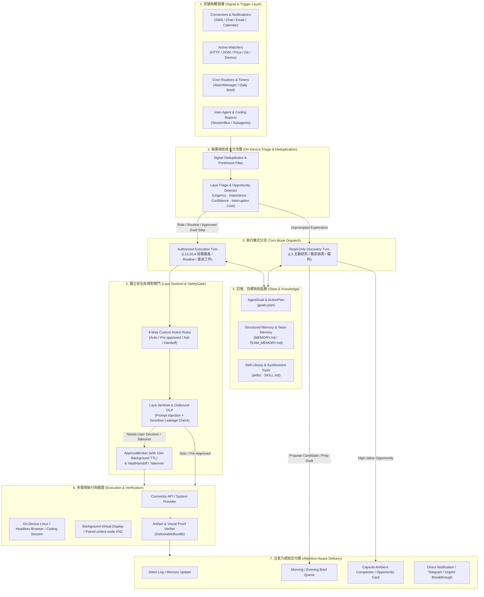

# Umbra Proactive AI Agents 完整功能規格書（Specification v1）

> **文件性質：** 產品與系統架構規格書（Specification Only，不含實作排程與 Implementation Plan）  
> **基準研究：** `/Users/chengmatt/Downloads/proactive_ai_agents_feature_research_2026-10-23.md`（OpenAI Dots、Meta Muse、Claude Duet、Instinct、Grok Bot 五大產品功能亮點研究）  
> **目標系統：** Umbra（Android 16 本機自主代理 + 內建 Debian Linux 環境 + `omp` 執行核心 + 本機 `Laya` 決策／安全側車 + `umbra-node` 遠端電腦節點）  
> **日期：** 2026-10-23（Asia/Taipei）  
> **語言：** 繁體中文（程式碼符號、資料結構、Tool 名稱與協定保留英文）

---

## 0. 規格目標與設計原則

本規格書評估並定義如何將 **OpenAI Dots**（持續專案責任與唯讀主動研究）、**Meta Muse**（長期目標拆解、情境記憶、主動建議、生活交易與 Sentinel 監督）、**Claude Duet**（注意力管理、每日晨報、低打擾通知、衝突偵測與事前準備）、**Instinct**（無新介面極低摩擦委派、模糊語意跨脈絡回查、安全憑證交接）以及 **Grok Bot**（多代理團隊協作、群組對話、示範教學轉技能 Teach a Task、可重用 Skills 與事件／排程 Routines）的所有核心亮點功能，整合進 Umbra 的既有架構中。

### 核心設計原則（Umbra Invariants）

1. **On-Device First & Zero Idle Footprint（本機優先、閒置零常駐模型）**：維持 `agents-2026-10.md` §8 的設計，`always-on` 代表排程器（`AgentService` + `AlarmManager`）、事件監聽器與輕量監測器（Watchers）在背景運作；**不代表 LLM 永久常駐記憶體**。所有初步過濾、重要性排序與安全分類優先由本機規則與 `LayaSidecar` 完成。
2. **Read-Only Discovery vs. Authorized Mutation（唯讀探索與授權修改嚴格分離）**：未經使用者當下直接指令觸發的「主動研究／機會探索」回合，強制執行 **Read-Only Sandbox**，僅可讀取已授權來源、寫入私有研究筆記與產生候選任務（`OpportunityCard`），絕不直接修改外部系統、發送外部訊息或操作付款。
3. **Attention as a Scarce Resource（使用者注意力即稀缺資源）**：通知與主動回報受「重要性 × 緊急度 × 信心度 − 打擾成本」模型管轄。非緊急事項自動收斂至每日晨報／晚報（`DailyBrief`）或 Capsule 靜默狀態。
4. **Connector-First, Visual-Fallback（結構化優先、視覺操作兜底）**：執行外部動作時，依序優先使用：`Official API / System Provider Connector` → `Headless Chromium DOM Browser` → `Background Virtual Display / X11 / umbra-node VNC Visual UI`。
5. **Independent Safety & Fail-Closed（獨立安全審查與失敗關閉）**：所有外部副作用、敏感資料外傳與高風險操作均經過 `SafetyGate` 靜態底線與 `LayaActionSecurityCheck`（擴充為 **Laya Sentinel**）雙重把關；背景自動工作之批准請求具備明確有效期限（Approval TTL），逾時一律失敗關閉（Fail-closed）。

---

## 1. 現況基線與全功能差距評估矩陣（Baseline & Gap Evaluation）

下表盤點 Umbra 現有程式碼庫（截至 v0.4.5）已具備之基礎建設，並評估引入五大 Proactive AI Agents 亮點功能所需的規格擴充：

| 領域 | 研究報告亮點功能（來源產品） | Umbra 現況基線（Existing Codebase） | 差距評估與規格擴充方向（Target Spec） |
|---|---|---|---|
| **長期目標與專案** | Persistent Goals、Goals→Action Plans、多專案並行、Dynamic Replanning（Dots, Muse, Grok Bot） | `Session` 具 `goal: String?` 與 `plan: List<PlanStep>`；`AgentStore` 僅有扁平 `QueueItem` 清單（`queue.json`） | 新增一級實體 `AgentGoal`（`goals.json`），支援里程碑（`GoalMilestone`）、驗收條件、進度追蹤、關聯 Sessions／Artifacts，以及環境變化時的動態重規劃（`goal_replan`）。 |
| **主動研究與探索** | Proactive Research 預設唯讀限制、Task/Opportunity Discovery、Unprompted Suggestions（Dots, Muse） | `AgentRuntime.wake` 喚醒後給予完整 `AgentTools` 與 `android_*` 工具，無「唯讀探索回合」與「授權執行回合」之分 | 新增 `ProactiveTurnMode.READ_ONLY_DISCOVERY` 執行沙箱、私有研究筆記（`notes/`）與結構化機會卡片 `OpportunityCard`（支援一鍵採納、編輯、忽略與偏好學習）。 |
| **主動監測器** | Active Monitoring（價格、天氣、網頁、狀態變更監測）（Muse, Dots, Grok Bot） | 僅支援 `IncomingSource`（訊息與 Android 通知）與 `AgentTimer`（固定時間喚醒 LLM） | 新增輕量級 `AgentWatcher`（`watchers.json`）：由 Linux guest 執行低成本條件檢查（HTTP/DOM/JSON/Git/系統狀態），**僅在條件成立時**才喚醒 Agent LLM。 |
| **注意力與晨報** | Morning Brief、Attention Prioritization、Smart Interruption、Conflict Detection、Preemptive Prep + Next Steps（Duet, Instinct） | `AgentRuntime.triage` 僅由 Laya 判斷 `NOW / LATER / IGNORE`；無每日彙整晨報、無行程衝突偵測與會前準備機制 | 新增 `AttentionRanker`（五級打擾分流）、`DailyBriefEngine`（晨報／晚報結構化卡片）、跨來源衝突偵測器（`ConflictDetector`）與會前自動備料 + 一鍵草稿（`PreparedNextStep`）。 |
| **個人情境記憶** | Contextual Personal Memory、個人風格學習、Team vs. Private Memory（Muse, Dots, Duet, Grok Bot） | `Memory`（`MEMORY.md`）為單行文字清單（`- date · source · text`），每次取最新 80 筆注入 Prompt | 升級為結構化分類記憶 `MemoryEntry`（偏好、人物、承諾、專案風格、禁忌規則），支援語意／關鍵字檢索、有效期限、來源撤銷連動，並新增跨 Agent 共享之 `TEAM_MEMORY.md`。 |
| **低摩擦與模糊理解** | No-New-Interface（SMS/Chat/Voice 委派）、模糊語意跨來源回查（Fuzzy Retrieval）、個人雲端／行事曆整合（Instinct, Muse, Duet） | 已有 Capsule、Telegram Bot 與訊息 Connectors；缺乏行事曆／郵件／訂單結構化檢索與模糊指代消解工具 | 新增 `context_resolve` 跨來源實體消解工具（聯合檢索通知、訊息、檔案、記憶與郵件／行事曆），並擴充 `CalendarConnector`、`EmailConnector` 與讀寫權限分級。 |
| **技能與示範教學** | Teach a Task（錄製操作轉 Skill）、Skill Extraction、Shared Skill Library、Skill Evolution、Self-Created Tools（Grok Bot, Muse） | `ScreenRecorder` 已支援錄製 3 分鐘畫面並產生 6 格縮圖 + Accessibility 時間軸（`glances`），但僅作為單次 `ContextChip` | 將 `ScreenRecorder` 擴充為 **Teach Mode**（最長 10 分鐘，記錄完整 UI Node Selector 與操作序列），自動提煉參數化 `SKILL.md`；建立跨 Agent 共享 `SkillStore`、自我演化修補與沙箱化自建工具（`tool_synthesize`）。 |
| **例行工作流** | Scheduled & Event-triggered Routines、明確持有者、執行歷史（最近 20 筆）、最小間隔與批准逾時（Grok Bot, Dots） | `AgentTimer`（`timers.json`）與 `AgentRule`（`rules.json`）各自獨立，無執行紀錄、無綁定 Skill、無背景批准到期機制 | 統一並升級為 `AgentRoutine`（支援 `CRON`、`EVENT`、`WATCHER` 觸發），每 Agent 上限 50 個、保留最近 20 筆 `RoutineRunRecord`、支援冪等鍵（Idempotency Key）與 10 分鐘背景批准 TTL。 |
| **多代理團隊** | Persistent Named Bots、Coordinator / Specialist 分工、Bots 互傳訊息、2–6 Bot Group Chats、Templates 分享（Grok Bot, Dots） | 已有 `AgentProfile`、`SessionBus`（1 對 1 `session_send`）與 `AgentPair`；無多 Agent 群組聊天室、無 Coordinator 委派協定與模板匯出 | 新增 `AgentGroup`（2–6 位 Agents + 使用者共處之群組會話）、Coordinator 結構化任務交棒協定（`handoff_delegate`），以及去識別化之 `AgentTemplateBundle` 匯出入規格。 |
| **執行環境與成果交付** | End-to-end Artifact Creation、自動測試＋變更影片 PR、Cloud/Local Computer Preview & Takeover、真實交易與付款保護（Dots, Muse, Grok Bot） | 已有本機 Debian、Android 背景虛擬螢幕、`umbra-node`（mTLS + VNC）、`GitProtection` 與 `CommitGate`；成果回報僅為純文字 `[Report from #…]` | 定義 `DeliverableBundle`（含檔案、Git Diff、測試結果與自動錄製之視覺驗證短片／縮圖表）、統一接管狀態機（`TakeoverSession`），以及電商比價／議價與 `CheckoutGate`（付款前攔截與遮罩交接）。 |
| **安全監督與憑證** | Custom Rules 四向處置、Sentinel Agent、Sensitive Data Leakage Guard、Secure Vault 登入交接、Budget Controls（Dots, Muse, Duet, Instinct, Grok Bot） | 已有 `ApprovalPolicy`、`AllowRule`（含 Literal Prefix）、`LayaActionSecurityCheck`、`CredentialVault` 與 `AiUsageLimit` | 新增四向自訂規則 `CustomActionRule`（`AUTO` / `PRE_APPROVED` / `ASK` / `HANDOFF_TO_USER`）、**Laya Sentinel 外傳敏感資訊防護（Outbound DLP）**、一次性安全憑證輸入連結 `VaultHandoff`，以及多 Agent 共用環境風險揭露。 |

---

## 2. Umbra 主動性架構與 L0–L4 成熟度規格

### 2.1 五階主動性成熟度在 Umbra 的定義

Umbra 支援每個 `AgentProfile` 依使用者授權與角色設定，運作於以下五種主動性成熟度等級（預設為 **L3**，高風險動作仍受 `SafetyGate` 約束）：

| 等級 | 名稱 | Umbra 系統行為規範 | 允許之寫入邊界 |
|---|---|---|---|
| **L0** | **Reactive** | 僅在使用者於 App、Capsule 或 Telegram 主動發訊時喚醒執行。 | 依當下對話與 `ApprovalPolicy` 執行。 |
| **L1** | **Scheduled** | 依 `AgentRoutine`（Cron 排程）或 `DailyBrief` 固定時間喚醒，執行已知例行任務。 | 僅限該 Routine 預授權範圍內之讀取與通知。 |
| **L2** | **Event-aware** | 當收到訊息、通知、`AgentWatcher` 條件成立或 `umbra-node`／Git 事件時，經 `Laya` 分流後即時喚醒反應。 | 可準備草稿、更新內部狀態，外部寫入需符合規則或請求批准。 |
| **L3** | **Opportunity-aware** | 在心跳或閒置研究視窗執行 **唯讀主動探索（Read-Only Discovery）**，自動偵測衝突、發現待辦、準備會前資料並提出 `OpportunityCard` 建議。 | **探索階段強制唯讀**（僅可寫入 `MEMORY.md`、`notes/` 與 `opportunities.json`）。 |
| **L4** | **Goal-driven Autonomous** | 持續追蹤 `AgentGoal`，自主拆解里程碑、派發子任務給 Specialist Agents 或 Coding Sessions、驗證產出物（`DeliverableBundle`），並在情況改變時動態重規劃。 | 在 `CustomActionRule` 預授權範圍與 `AiUsageLimit` 預算內自主推進；觸及高風險或付款／外部發訊門檻時精準請求人類決策。 |

### 2.2 端到端主動性資料流（Proactive Pipeline）



---

## 3. 長期目標、行動計畫與動態重規劃（Persistent Goals & Dynamic Replanning）

> **對標亮點：** OpenAI Dots（Persistent Responsibility、一次管理多個進行中專案、Dynamic Replanning）、Meta Muse（長期個人目標 Goals → Action Plans、持續追蹤與調整計畫）、Grok Bot（長期領域 Ownership、主動續接停滯事項）。

### 3.1 資料模型（`agents/<agentId>/goals.json`）

每個 Agent 可同時持有並推進多個長期目標（`AgentGoal`）。目標跨對話與重啟持續存在，不因單次 Session 結束而消失。

```kotlin
@Serializable
data class AgentGoal(
    val id: String,                          // e.g., "g1"
    val agentId: String,
    val title: String,
    val description: String,
    val category: GoalCategory = GoalCategory.PROJECT, // PROJECT, PERSONAL_LIFE, RESEARCH, MAINTENANCE
    val state: GoalState = GoalState.IN_PROGRESS,
    val priority: Int = 2,                   // 1 (Low) .. 4 (Critical)
    val acceptanceCriteria: List<String> = emptyList(),
    val milestones: List<GoalMilestone> = emptyList(),
    val linkedSessionIds: List<String> = emptyList(),  // 關聯之 Coding Sessions 或 Subagents
    val linkedRoutineIds: List<String> = emptyList(),  // 關聯之週期性檢查 Routines
    val deliverables: List<DeliverableRef> = emptyList(),
    val replanHistory: List<ReplanRecord> = emptyList(),
    val checkCadenceCron: String? = null,    // 定期檢視與推進此目標之 Cron（如每日 10:00）
    val deadlineMs: Long? = null,
    val stalledAfterHours: Int = 48,         // 超過此時數無進度視為停滯（Stalled），觸發主動跟進
    val createdAtMs: Long,
    val updatedAtMs: Long,
    val lastProgressAtMs: Long = createdAtMs,
)

@Serializable
enum class GoalState {
    /** 持續推進中 */
    IN_PROGRESS,
    /** 等待特定時間、外部事件或排程觸發 */
    SCHEDULED,
    /** 等待使用者批准、回答問題或手動接管 */
    WAITING_USER,
    /** 因外部相依或錯誤暫停，需重規劃 */
    BLOCKED,
    /** 已由使用者手動暫停 */
    PAUSED,
    /** 所有里程碑與驗收條件皆已達成並交付 */
    COMPLETED,
    /** 已取消或封存 */
    ARCHIVED,
}

@Serializable
data class GoalMilestone(
    val id: String,                          // e.g., "ms1"
    val title: String,
    val status: String = "pending",          // pending | active | verifying | done | failed | skipped
    val assignedTo: String? = null,          // null (own), "@SpecialistAgent", or "#coding-session"
    val dependsOn: List<String> = emptyList(),
    val verificationRule: String? = null,    // 完成前需通過之檢查描述
    val artifactPath: String? = null,
    val updatedAtMs: Long,
)

@Serializable
data class ReplanRecord(
    val atMs: Long,
    val trigger: String,                     // "user_redirect" | "new_evidence" | "step_failed" | "constraint_changed"
    val summary: String,                     // 變更原因與計畫調整摘要
)
```

### 3.2 行為規範（Behavioral Rules）

1. **Goal Decomposition（目標拆解）**：當使用者在對話中提出跨日或多步驟需求（例如：「幫我規劃下個月去京都的行程並控制在預算內」、「持續追蹤這個 Repo 的 Crash 回報並發 PR 修復」），Agent 呼叫 `goal_create` 建立 `AgentGoal` 與初始 `GoalMilestone` 清單，而非僅當作單輪問答。
2. **Dynamic Replanning（動態重規劃）**：當發生以下任一情況時，Agent 在下一次喚醒回合呼叫 `goal_replan`：
   - 使用者修改需求、預算或優先順序；
   - `AgentWatcher`、訊息或研究筆記發現新事實（例如：航班改期、API 規格變更、測試失敗）；
   - 子任務失敗或外部環境阻斷。
   `goal_replan` 會更新未完成的 `milestones`、記錄 `ReplanRecord`，並在必要時向关聯的進行中 Coding Session 發送 `session_send(urgent = true)` 調整方向。
3. **Stalled Goal Follow-up（停滯目標主動續接）**：若 `GoalState.IN_PROGRESS` 的目標距離 `lastProgressAtMs` 超過 `stalledAfterHours`，心跳迴圈會在 Digest 中標記 `[Stalled Goal: <id>]`，提示 Agent 主動檢查阻塞原因、跟進外部回覆或向使用者提出下一步建議。
4. **Multi-Project Visibility（多專案狀態可見度）**：Agent 頁面與 Home 的 Agents 分頁清楚呈現該 Agent 負責的所有目標狀態（`In progress`、`Scheduled`、`Waiting on you`、`Completed`），點擊任一目標可展開里程碑進度、關聯的 Coding Sessions 與已交付成果。

### 3.3 新增 Agent Host Tools

- `goal_create(title, description, acceptance_criteria[], milestones[], priority?, deadline?, check_cron?)`
- `goal_update(goal_id, state?, milestone_id?, milestone_status?, deliverable_path?, note?)`
- `goal_replan(goal_id, reason, updated_milestones[], notify_linked_sessions?)`
- `goal_list(state_filter?)`

---

## 4. 唯讀主動研究、機會發現與主動監測器（Read-Only Discovery, Opportunity Detector & Watchers）

> **對標亮點：** OpenAI Dots（Proactive Research 預設唯讀限制、Task Discovery）、Meta Muse（Unprompted Suggestions、Active Monitoring）、Claude Duet（Proactive Conflict Detection）。

### 4.1 唯讀主動研究沙箱（`ProactiveTurnMode.READ_ONLY_DISCOVERY`）

為落實 Dots 的核心安全邊界（「尚未有當下新指示的主動研究只能讀取已授權資訊與寫入私人筆記，不能直接對外發訊、透過 Plugin 修改外部資料或操作瀏覽器／電腦執行外部副作用」），`AgentRuntime` 將 Agent 的喚醒回合明確區分為兩種執行模式：

| 屬性 | `READ_ONLY_DISCOVERY`（唯讀探索回合） | `AUTHORIZED_EXECUTION`（授權執行回合） |
|---|---|---|
| **觸發來源** | 例行 Heartbeat 背景巡檢、非緊急通知彙整、閒置主動研究、Morning Brief 準備階段 | 使用者直接發訊、已綁定授權之 `AgentRoutine`、使用者點擊核准之 `OpportunityCard`、已授權之 `AgentGoal` 執行步驟 |
| **允許之工具** | `memory_*`、`note_*`（私有研究筆記）、`notifications_query`、`messages_list`、`messages_read`、`calendar_read`、`email_read`、`sessions_list`、`session_read`、`goal_list`、`watcher_list`、唯讀型 `web_fetch`、`opportunity_propose`、`brief_stage` | 完整 `AgentTools`、`coding_start`、`messages_send`、`android_*`、`remote_node_*`（仍受 `SafetyGate` 與 `ApprovalPolicy` 管轄） |
| **禁止之行為（硬性攔截）** | **硬性禁止**呼叫 `messages_send`、`android_tap/type/swipe/shell`、`coding_start`（除非標記 `readOnlyResearch = true` 之純檢索子工作）、外部 HTTP `POST/PUT/DELETE/PATCH` | 依 `SafetyGate`、`CustomActionRule` 與 `LayaActionSecurityCheck` 決定自動執行或請求批准 |
| **轉化為執行的方式** | 產出 `OpportunityCard` 或 `PreparedNextStep` 草稿，由使用者一鍵點擊「執行（Approve & Run）」，或命中使用者預先建立的 `AgentRoutine`／`CustomActionRule(AUTO_EXECUTE)` 時，才升級為 `AUTHORIZED_EXECUTION` 回合。 | — |

### 4.2 主動機會發現與無提示建議（`OpportunityCard`）

在 `READ_ONLY_DISCOVERY` 回合中，Agent 從訊息、通知、行事曆、Git 狀態或研究筆記中發現高價值待辦或異常時，透過 `opportunity_propose` 產出結構化建議卡片（儲存於 `agents/<agentId>/opportunities.json`）：

```kotlin
@Serializable
data class OpportunityCard(
    val id: String,                          // e.g., "opp_102"
    val agentId: String,
    val kind: Kind,                          // TASK_DISCOVERY, CONFLICT_ALERT, FOLLOW_UP, PRICE_OR_MONITOR, GOAL_SUGGESTION
    val title: String,                       // 一句話標題，如「Slack 中有 3 位用戶回報登入閃退」
    val summary: String,                     // 發現內容與建議原因
    val evidenceRefs: List<String>,          // 證據來源標籤，如 ["whatsapp:chat_42", "notif:com.slack#881"]
    val urgency: Float,                      // 0.0 .. 1.0
    val confidence: Float,                   // 0.0 .. 1.0
    /** 預先準備好的可執行下一步（Duet Preemptive Next Steps） */
    val preparedAction: PreparedNextStep,
    val state: State = State.PENDING,        // PENDING, ACCEPTED, DISMISSED, EXPIRED
    val createdAtMs: Long,
    val expiresAtMs: Long? = null,
) {
    @Serializable
    enum class Kind { TASK_DISCOVERY, CONFLICT_ALERT, FOLLOW_UP, PRICE_OR_MONITOR, GOAL_SUGGESTION }
    @Serializable
    enum class State { PENDING, ACCEPTED, DISMISSED, EXPIRED }
}

@Serializable
data class PreparedNextStep(
    val label: String,                       // 按鈕文字，如「啟動 Coding Session 調查並建立 PR」或「傳送改期回覆草稿」
    val actionType: String,                  // "start_coding" | "send_message_draft" | "create_goal" | "run_skill" | "agent_turn"
    val payloadJson: String,                 // 預填之完整參數（如草稿內文、目標倉庫、指令）
    val secondaryOptions: List<String> = emptyList(), // 替代選項，如 ["改約週四 15:00", "改約週五 10:00"]
)
```

- **回饋迴路（Preference Learning）**：當使用者對 `OpportunityCard` 點擊「忽略（Dismiss）」並選擇「減少此類建議（Less like this）」時，系統自動在該 Agent 的 `MEMORY.md` 寫入一條 `FEEDBACK_RULE` 類別的記憶，並更新 `AttentionRanker` 的來源權重，避免重複打擾。

### 4.3 輕量級條件式主動監測器（`AgentWatcher`）

為實現 Meta Muse 的 **Active Monitoring**（監測價格變動、庫存、天氣、航班、網頁內容更新、GitHub PR 狀態）且不消耗 LLM 額度與手機電力，Umbra 在 `AgentStore` 新增 `watchers.json`：

```kotlin
@Serializable
data class AgentWatcher(
    val id: String,                          // e.g., "w1"
    val agentId: String,
    val title: String,                       // e.g., "監測京都飯店價格低於 ¥25,000"
    val probe: ProbeSpec,
    val condition: ConditionSpec,
    val intervalMinutes: Int = 30,           // 5 .. 1440 分鐘
    val onMatchInstruction: String,          // 條件成立時交給 Agent 的指令
    val lastCheckedMs: Long = 0,
    val lastValue: String? = null,
    val lastHash: String? = null,
    val triggerOnce: Boolean = true,         // 觸發後自動停用或持續監測每次變化
    val enabled: Boolean = true,
)

@Serializable
sealed interface ProbeSpec {
    /** 擷取網頁之 CSS selector 文字或 JSON 欄位（於 Linux guest 執行，不開 LLM） */
    @Serializable data class HttpOrCss(val url: String, val selectorOrJsonPath: String, val headers: Map<String, String> = emptyMap()) : ProbeSpec
    /** 執行本機 Linux guest 內之唯讀檢測指令（上限 10 秒，無外部寫入） */
    @Serializable data class GuestCheckCommand(val argv: List<String>, val workingDir: String? = null) : ProbeSpec
    /** 監看特定 App 通知或訊息符合正則／數值條件 */
    @Serializable data class NotificationPattern(val packageName: String?, val regex: String) : ProbeSpec
}

@Serializable
sealed interface ConditionSpec {
    @Serializable data object Changed : ConditionSpec
    @Serializable data class Contains(val substring: String, val ignoreCase: Boolean = true) : ConditionSpec
    @Serializable data class NumericCompare(val op: String, val threshold: Double) : ConditionSpec // "<", "<=", ">", ">=", "=="
    @Serializable data class LayaVerify(val question: String) : ConditionSpec // 由本機 Laya 判斷擷取結果是否符合語意條件
}
```

- **運作方式**：每次 `AgentRuntime.tick()` 時，到期的 `AgentWatcher` 先在背景執行輕量 `ProbeSpec` 與 `ConditionSpec` 比對。若未命中條件，**完全不啟動 `omp` / 雲端 LLM**，僅更新 `lastCheckedMs`；一旦條件成立，立即以 `Reason.WATCHER` 喚醒所屬 Agent。

### 4.4 新增 Agent Host Tools

- `note_write(topic, content, append?)` / `note_read(topic)` / `note_list()`：管理 `agents/<id>/notes/` 下之私人研究筆記。
- `opportunity_propose(kind, title, summary, evidence_refs[], urgency, action_label, action_type, action_payload)`：提出主動建議卡片。
- `watcher_add(title, probe_type, target, selector_or_pattern, condition, interval_minutes, on_match, trigger_once?)`
- `watcher_list()` / `watcher_remove(id)`

---

## 5. 注意力管理、每日晨報與預先準備（Attention-First Engine, Daily Brief & Preemptive Prep）

> **對標亮點：** Claude Duet（每日 Morning Brief、Attention Prioritization、Smart Interruption、Proactive Conflict Detection、Preemptive Preparation + 順手準備 Next Steps）、Instinct（處理郵件／行程時順便指出時間衝突）。

### 5.1 注意力排序與低打擾分流模型（`AttentionRanker`）

取代現有僅區分 `NOW / LATER / IGNORE` 的三分法，`AttentionRanker` 結合 `LayaSidecar` 與裝置當下狀態，對每一筆待通知事項或 `OpportunityCard` 計算綜合注意力分數：

$$\text{AttentionScore} = (0.40 \times U + 0.35 \times I + 0.25 \times C) - \text{InterruptionCost}$$

- **$U$（Urgency 緊急度，$0.0\sim 1.0$）**：是否有時間敏感性（例如：30 分鐘內開會、真人一對一等待回覆、系統／建置失敗、即將到期的預訂）。
- **$I$（Importance 重要度，$0.0\sim 1.0$）**：發訊者或事件與使用者 `MEMORY.md`（重要聯絡人、客戶、主管）、進行中 `AgentGoal` 的關聯度。
- **$C$（Confidence 信心度，$0.0\sim 1.0$）**：`Laya` 或 Agent 對該判斷之把握度（低於 `0.65` 不主動打擾）。
- **$\text{InterruptionCost}$（打擾成本，$0.0\sim 1.0$）**：由手機即時狀態決定：
  - 通話中（`AudioManager.MODE_IN_COMMUNICATION` / `MODE_IN_CALL`）或會議中：`+0.60`
  - 全螢幕應用（遊戲、影片播放）或使用者正在前景快速輸入：`+0.35`
  - 處於 Agent 設定之 `Quiet Hours` 或系統勿擾模式（DND）：`+0.70`
  - 一般待機或桌面瀏覽：`+0.00`

#### 五級交付通道（Delivery Tiers）

| 分數區間 / 條件 | 交付等級（Tier） | 介面行為 |
|---|---|---|
| `< 0.20` | `SILENT_LOG` | 僅記錄於活動歷史或 `MEMORY.md`，不推播、不顯示 Badge。 |
| `0.20 .. 0.49` | `BRIEF_QUEUE` | 收納進下一份 **Morning Brief / Evening Wrap-up** 彙整卡片，當下不打擾。 |
| `0.50 .. 0.69` | `CAPSULE_AMBIENT` | 僅在浮動 Capsule 顯示柔和狀態提示或於 Home 的 Agent 列顯示未讀圓點，無音效與震動。 |
| `0.70 .. 0.89` | `STANDARD_NOTIFY` | 發送標準通知（或轉發至已連結之 Telegram），Capsule 輕觸震動（`CONFIRM`）。 |
| `>= 0.90`（且 $U \ge 0.85$） | `URGENT_BREAKTHROUGH` | 可穿透 Quiet Hours 發送高優先級通知（`CHANNEL_URGENT`），Capsule 呈現琥珀色環。 |

### 5.2 每日晨報與晚報引擎（`DailyBriefEngine`）

每個 Agent（或由預設之主助理／Coordinator Agent 統籌）支援每日定時產生 **Morning Brief（晨報）** 與選配之 **Evening Wrap-up（晚報）**：

```kotlin
@Serializable
data class DailyBrief(
    val id: String,                          // e.g., "brief_2026-10-23_am"
    val date: String,                        // "2026-10-23"
    val kind: Kind,                          // MORNING, EVENING
    val headline: String,                    // 一句話總結今日重點
    val scheduleHighlights: List<BriefItem>, // 今日重要行程與已備妥之會前簡報連結
    val conflictsDetected: List<ConflictAlert>, // 偵測到的時間／承諾衝突與建議解法
    val overnightCompleted: List<BriefItem>, // 離線期間完成的 Coding Sessions、Routines 與監測結果
    val attentionNeeded: List<OpportunityCard>, // 濃縮後最值得使用者決策的 1~5 件事（附一鍵 Next Steps）
    val lowPriorityDigest: String,           // 收納於 BRIEF_QUEUE 的次要訊息／通知摘要
    val generatedAtMs: Long,
) {
    @Serializable enum class Kind { MORNING, EVENING }
}

@Serializable
data class BriefItem(
    val title: String,
    val detail: String,
    val linkedSessionId: String? = null,
    val linkedGoalId: String? = null,
    val preparedStep: PreparedNextStep? = null,
)

@Serializable
data class ConflictAlert(
    val id: String,
    val severity: String,                    // "hard_overlap" | "travel_buffer_tight" | "commitment_mismatch"
    val description: String,                 // e.g., "14:00 牙醫預約與 14:30 客戶通話重疊；從診所返家需 25 分鐘"
    val sources: List<String>,               // ["calendar:evt_91", "whatsapp:clinic_chat"]
    val resolutionOptions: List<PreparedNextStep>, // 預先擬好的改期訊息草稿或行事曆調整動作
)
```

### 5.3 主動衝突偵測與事前準備（Proactive Conflict Detection & Preemptive Preparation）

1. **Proactive Conflict Detection（跨來源衝突偵測）**：
   - 當新訊息、通知或行事曆事件進入時，Agent 自動比對未來 7 天內之行事曆事件、`AgentTimer` 與 `MEMORY.md` 中的承諾事項（`COMMITMENT`）。
   - 偵測範圍包含：(a) 時間直接重疊、(b) 錯誤的星期／日期對應（例如訊息寫「下週二 10/29」，但 10/29 實際為週四）、(c) 跨地點移動緩衝不足、(d) 雙重答應不同對象。
   - 一旦偵測到衝突，立即產生 `ConflictAlert` 並附上可直接發送的改期草稿（`PreparedNextStep`）。
2. **Preemptive Preparation（會前／事前自動備料）**：
   - 在行事曆重要會議、通話或面試開始前 $N$ 分鐘（預設 30 分鐘），背景自動觸發 `READ_ONLY_DISCOVERY` 回合：
     1. 檢索與會者在 `MEMORY.md`、過往訊息、Email 與相關專案 `Workspace` 中的最新進度；
     2. 產生一頁精簡 **Pre-Meeting Dossier（會前備忘卡片）**：與會者背景、上次討論結論、未決問題、我方待辦狀態；
     3. 推送至 Capsule 與 Agent 對話，讓使用者在會議開始前一眼掌握。

---

## 6. 結構化個人情境記憶與跨來源模糊語意檢索（Contextual Memory & Fuzzy Entity Resolution）

> **對標亮點：** Meta Muse（Contextual Personal Memory：保留飲食限制、人物關係、食譜偏好）、Instinct（模糊語意理解：只描述物品外觀即回查歷史訂單辨識退貨商品、Cross-context Retrieval、Google Workspace 整合）、OpenAI Dots（個人風格與審稿標準學習）。

### 6.1 結構化情境記憶規格（`Memory v2`）

保留 `MEMORY.md` 作為人類可直接檢視與編輯的 Markdown 檔案（相容既有設計），同時在語法與索引層擴充結構化標籤與跨 Agent 共享記憶：

#### 單筆記憶格式（`MEMORY.md` 與 `TEAM_MEMORY.md`）
`- YYYY-MM-DD · [category] · source · text (tags: #tag1, #tag2)`

```kotlin
@Serializable
enum class MemoryCategory {
    /** 飲食、作息、溝通語氣、偏好品牌、審稿與程式碼品質標準 */
    PREFERENCE,
    /** 親友、同事、客戶之關係、聯絡方式、重要特徵（如飲食禁忌、職稱） */
    PERSON,
    /** 答應他人的事項、截止日、定期義務 */
    COMMITMENT,
    /** 專案慣例、Repo 架構偏好、常用指令與部署規則 */
    PROJECT_STYLE,
    /** 訂單、保固、預約編號、常用地址或非機密實體資訊 */
    ENTITY_FACT,
    /** 使用者明確指示「不要做什麼」或對主動建議的負面回饋 */
    FEEDBACK_RULE,
}
```

#### 雙層記憶隔離（Personal vs. Team Memory）
- **Agent 專屬記憶（`agents/<id>/MEMORY.md`）**：該 Agent 在自身職責領域內學到的細節與對話脈絡。
- **全域共享記憶（`agents/TEAM_MEMORY.md`）**：使用者基本偏好、重要人脈關係與通用安全規則，所有 Running Agents 皆可讀取；任一 Agent 呼叫 `memory_add(shared = true)` 時寫入共享記憶。
- **智慧注入與檢索（Context-Aware Memory Injection）**：當 `MEMORY.md` 超過 80 筆時，不再無腦截斷前段，而是固定注入所有 `FEEDBACK_RULE` + 最近 30 筆記憶 + 與當下訊息／目標關鍵字最相關的 Top 30 筆歷史記憶。
- **撤銷與遺忘連動（Source Revocation Purge）**：當使用者中斷某個 Connector 或將某 App 設為 `Ignore` 時，UI 提供勾選「一併清除由此來源學到的記憶（`source == <connector>`）」，解決 Dots 報告中指出的「中斷連接不必然刪除既有記憶」問題。

### 6.2 跨脈絡模糊語意回查工具（`context_resolve`）

為支援 Instinct 式的極低摩擦模糊委派（例如使用者在 Telegram 或 Capsule 只說：「幫我退掉上個月買的那個白色直立架」、「幫我跟上次洗牙那間診所約下週檢查」），新增專用的跨來源聯合檢索工具 `context_resolve`：

| 參數 | 類型 | 說明 |
|---|---|---|
| `query` | `String` | 使用者的模糊描述或拆解出的關鍵詞（支援多語意同義詞擴展，如 `["白色", "直立架", "stand", "shelf", "IKEA", "訂單"]`） |
| `sources` | `List<String>?` | 欲搜尋之來源：`["messages", "notifications", "memory", "email", "calendar", "files", "workspaces"]`（預設全搜） |
| `time_window_days` | `Int?` | 搜尋時間範圍（預設 90 天） |
| `entity_type` | `String?` | `"order"` \| `"person"` \| `"appointment"` \| `"document"` \| `"any"` |

- **執行邏輯**：在裝置端並行查詢 `notifications.db`（解密後比對）、`messages.db`、`EmailConnector`、`CalendarConnector`、`MEMORY.md` 與最近存取的檔案索引，由 `Laya` 或檢索排序器依相關度回傳 Top-K 證據片段（含訂單編號、商家名稱、聯絡人資訊、原始訊息時間戳）。Agent 必須先執行 `context_resolve` 確認找不到唯一候選時，才向使用者追問。

### 6.3 個人情境連接器與細粒度讀寫權限（Personal Context Connectors & Granular Scopes）

擴充 `app.umbra.agent.connectors` 架構，除了既有 9 種即時通訊來源外，納入個人生活與辦公核心資料源，並實施 Meta Muse 式的 **Granular App Permissions**：

| 連接器（Connector ID） | 整合方式 | 權限等級（Capability Scopes） |
|---|---|---|
| `calendar` | Android `CalendarContract` Provider / CalDAV / Google Calendar API | `READ_ONLY`（預設）\| `PROPOSE_EVENT`（建立草稿待確認）\| `WRITE_EVENTS`（允許新增／修改行程） |
| `email` | IMAP + SMTP / JMAP / Gmail OAuth API | `READ_ONLY`（預設，支援訂單／帳單／預約解析）\| `DRAFT_ONLY`（僅存草稿匣）\| `SEND_WITH_APPROVAL` |
| `contacts` | Android `ContactsContract`（唯讀聯絡人姓名、稱謂與關聯帳號） | `READ_ONLY`（用於 `context_resolve` 辨識人物與驗證聯絡資訊） |
| `tasks` | Android 本機待辦 / Google Tasks / CalDAV VTODO | `READ_ONLY` \| `WRITE_TASKS` |
| `drive_files` | Android SAF Document Provider / 已掛載之本地與雲端同步資料夾 | `READ_ONLY` \| `WORKSPACE_COPY` \| `DIRECT_EDIT`（受 `GitProtection` 保護） |

---

## 7. 技能系統、示範教學與例行工作流（Skills, Teach-by-Demonstration & Routines）

> **對標亮點：** Grok Bot（Learn from Demonstration — Teach a Task 錄製 10 分鐘操作轉 Skill、Skill Extraction、Shared Skill Library、Skill Evolution、Scheduled & Event-triggered Routines、每 Bot 50 個 Routines 與最近 20 筆紀錄、10 分鐘背景批准到期）、Meta Muse（動態組合 Skills、自行建立缺失工具 Tool Creation）。

### 7.1 可重用技能規格（`UmbraSkill` & `SKILL.md`）

在 `filesDir/skills/<skillId>/` 建立跨 Agent 與 Coding Session 共用的 **Shared Skill Library**：

```kotlin
@Serializable
data class UmbraSkill(
    val id: String,                          // e.g., "skill_ikea_return"
    val name: String,
    val description: String,                 // 供 Agent 與 Laya 進行動態技能選擇（Dynamic Skill Composition）
    val ownerAgentId: String? = null,        // null 代表全域共享（Shared Skill Library）
    val executionTarget: ExecutionTarget,    // CONNECTOR_API, HEADLESS_BROWSER, ANDROID_VISUAL, LINUX_CLI, REMOTE_NODE
    val parameters: List<SkillParam> = emptyList(),
    val verificationChecks: List<String> = emptyList(), // 完成前必須驗證的條件
    val approvalBoundary: String,            // 明確記載哪一步必須停下來請使用者批准（如「送出退貨申請前」）
    val idempotencyRule: String? = null,     // 避免重複執行的檢查方法（如「先檢查今日是否已建立相同標題之紀錄」）
    val version: Int = 1,
    val createdFrom: String = "manual",      // "demonstration" | "task_extraction" | "synthesized" | "manual"
    val successCount: Int = 0,
    val failureCount: Int = 0,
    val updatedAtMs: Long,
)

@Serializable
data class SkillParam(val name: String, val type: String, val description: String, val required: Boolean = true, val defaultValue: String? = null)
```

每個技能目錄包含：
- `skill.json`：上述結構化中繼資料。
- `SKILL.md`：包含前置條件（Freshness Check）、步驟說明、UI Selector / DOM Selector 參考、邊界案例（Edge Cases）與驗證規則。
- `scripts/`（選配）：若為 Muse 式「自建工具（Synthesized Tool）」，存放於沙箱內執行的 Python / Bun / Bash 腳本。

### 7.2 示範教學轉技能：Teach a Task（`DemonstrationRecorder`）

直接擴充 Umbra 既有的 `ScreenRecorder`（`app/src/main/kotlin/app/umbra/agent/capsule/ScreenRecorder.kt`）：

1. **啟動方式**：使用者在 Capsule、Skills 頁面或 Agent 對話點擊 **「示範教學（Teach a Task）」**。
2. **雙軌錄製（最長 10 分鐘）**：
   - `ScreenRecorder.MAX_MS` 在 Teach Mode 下擴充為 **10 分鐘（`10 * 60_000L`）**，支援手機主畫面、瀏覽器或 `umbra-node` 遠端畫面。
   - **視覺軌**：每當發生點擊、輸入或頁面切換時，擷取帶時間戳之關鍵影格（Keyframes）。
   - **結構化無障礙／DOM 軌（Action Trace）**：由無障礙服務同步記錄每一次使用者互動之套件名稱（`packageName`）、視窗標題、目標節點之 `viewIdResourceName`、`text`、`contentDescription`、座標邊界與動作類型（`CLICK`、`TYPE`、`SCROLL`）。**若目標欄位 `isPassword == true`，輸入內容自動遮罩為 `[SECRET_INPUT_HANDOFF]`，絕不寫入技能檔。**
3. **技能提煉與人工驗證（Skill Extraction & Verification Gate）**：
   - 錄製結束後，Agent 分析關鍵影格與 Action Trace，自動生成參數化的 `UmbraSkill` 草稿（自動將固定字串抽換為 `SkillParam`，並標註批准邊界與驗證步驟）。
   - **強制人工測試閉環**：新提煉之 Skill 初始狀態為 `DRAFT`，使用者可檢視、修改步驟規則並點擊「試跑一次（Test Run）」驗證無誤後，才正式啟用或綁定至 Routine。

### 7.3 技能演化與自建缺失工具（Skill Evolution & Self-Created Tools）

1. **從成功任務提煉技能（`skill_extract_from_session`）**：當一個複雜的 Coding Session 或多步驟手機操作成功完成後，使用者或 Agent 可一鍵將該次軌跡提煉為可重用 `UmbraSkill`。
2. **技能自我演化（`skill_propose_patch`）**：當既有 Skill 因目標網站改版或 App UI 更新而失敗，Agent 在重試成功後，可提出 `SKILL.md` 的版本修補（Diff），記錄新的 Selector 與 Fallback 邏輯。
3. **自建缺失工具（`tool_synthesize`，對標 Meta Muse）**：
   - 當任務需要特定資料轉換、API 呼叫或自動化解析，而現有 Host Tools 未提供時，Agent 可在 Linux 環境之受控目錄 `/home/agent/.umbra/synthesized-tools/<tool-name>/` 撰寫獨立腳本與 JSON Schema，並編寫單元測試驗證。
   - 註冊為 Agent 可呼叫之動態工具前，必須通過 `ShellRiskAnalyzer` 靜態掃描與 `Laya Sentinel` 程式碼審查，並經使用者核准。

### 7.4 結構化例行工作流（`AgentRoutine`）

將原有的 `AgentTimer` 與 `AgentRule` 升級整合為具備完整生命週期、執行歷史與安全邊界的 **`AgentRoutine`**（儲存於 `agents/<id>/routines.json`）：

```kotlin
@Serializable
data class AgentRoutine(
    val id: String,                          // e.g., "rt_1"
    val ownerAgentId: String,                // 明確持有與負責執行之 Agent
    val title: String,
    val trigger: RoutineTrigger,
    val skillId: String? = null,             // 綁定之可重用 Skill（可選）
    val instruction: String,                 // 補充指令或無 Skill 時之執行要求
    val skillArgs: Map<String, String> = emptyMap(),
    val allowedConnectors: List<String> = emptyList(), // 最小權限範圍
    val approvalTTLMinutes: Int = 10,        // 背景批准卡有效期限（預設 10 分鐘，對標 Grok Bot）
    val idempotencyWindowMinutes: Int = 5,   // 最小觸發間隔與去重時間窗（>= 5 分鐘）
    val enabled: Boolean = true,
    val createdAtMs: Long,
    val lastRunAtMs: Long? = null,
    val recentRuns: List<RoutineRunRecord> = emptyList(), // 保留最近 20 筆執行紀錄
) {
    companion object {
        const val MAX_ROUTINES_PER_AGENT = 50
        const val MAX_RUN_HISTORY = 20
        const val MIN_INTERVAL_MINUTES = 5
    }
}

@Serializable
sealed interface RoutineTrigger {
    /** 固定時間排程（最小間隔 5 分鐘） */
    @Serializable data class CronSchedule(val cron: String, val zoneId: String) : RoutineTrigger
    /** 外部或內部事件觸發（Slack/WhatsApp/SMS 訊息、特定 App 通知、行事曆變動、Git/Node Webhook） */
    @Serializable data class EventMatch(
        val source: String,                  // connector id, package name, "calendar", "git", "watcher"
        val senderOrChannelFilter: String? = null,
        val textContains: String? = null,
        val semanticCondition: String? = null, // 由 Laya 進行低成本語意條件過濾
    ) : RoutineTrigger
    /** 手動觸發 */
    @Serializable data object Manual : RoutineTrigger
}

@Serializable
data class RoutineRunRecord(
    val runId: String,
    val startedAtMs: Long,
    val finishedAtMs: Long?,
    val status: String,                      // "succeeded" | "failed" | "approval_expired" | "skipped_idempotent"
    val summary: String,
    val deliverablePath: String? = null,
    val error: String? = null,
)
```

---

## 8. 多代理團隊協作、群組對話與角色模板（Multi-Agent Teams, Group Chats & Templates）

> **對標亮點：** Grok Bot（Persistent Named Bots、Role-based Ownership、Coordinator / Chief-of-Staff Pattern、2–6 位 Bots Group Chats、Shared Templates / Marketplace）、OpenAI Dots（Specialist Dots）。

### 8.1 Coordinator / Specialist 協作模式

Umbra 支援將一位 Agent 設為 **Coordinator（幕僚長／總協調者，即預設 Capsule 對話對象）**，其餘 Agents 設為具備特定領域職責與專屬連接器權限的 **Specialists（專家代理）**（例如：`@Mia` 負責收件匣與訊息分流、`@DevBot` 負責監看 GitHub 與啟動 Coding Sessions、`@LifeBot` 負責採買、旅遊與帳單監測）：

- **Permission Scoped per Agent（依代理隔離連接器權限）**：每個 `AgentProfile` 的 `channels` 與 `allowedConnectors` 獨立設定。`@DevBot` 不需擁有讀取個人 WhatsApp 的權限；`@LifeBot` 不需擁有存取生產環境 Git Repository 的權限。
- **Structured Task Handoff（結構化任務交棒 `handoff_delegate`）**：
  - 擴充 `SessionBus`（`core/orchestrator/SessionBus.kt`），除了自由文字 `session_send` 外，新增結構化交棒訊息 `SessionBus.Kind.HANDOFF`，攜帶：`goalId`、`milestoneId`、`expectedDeliverable`、`deadlineMs` 與 `contextRefs`。
  - 當 Specialist 完成交辦事項時，透過 `handoff_complete(handoff_id, status, summary, deliverable_path)` 自動回報給 Coordinator 並更新對應的 `GoalMilestone`。

### 8.2 多代理群組對話室（`AgentGroup` — 2–6 Agents + User）

在 `AgentStore`（`agents/groups.json`）與 `SessionBus` 新增多方群組對話支援，讓使用者可拉 2 至 6 位 Agents 進入同一個群組聊天室共同討論、腦力激盪或現場分工：

```kotlin
@Serializable
data class AgentGroup(
    val id: String,                          // e.g., "grp_product_launch"
    val name: String,
    val avatar: String = "g1",
    val memberAgentIds: List<String>,        // 2 .. 6 位 Agent IDs
    val coordinatorAgentId: String,          // 預設主持與收斂結論之 Agent
    val createdAtMs: Long,
    val lastMessageAtMs: Long = createdAtMs,
)
```

#### 群組發言與防迴圈仲裁規則（Group Turn Arbitration）
1. **明確點名優先**：當使用者或某位 Agent 在群組訊息中 `@AgentName`，由被點名的 Agent 依序接手下一回合。
2. **Laya 相關性點名**：若使用者未點名任何 Agent，由 `Laya` 根據各成員之 `SOUL.md` 選出最相關的 1～2 位成員回應，或由 `coordinatorAgentId` 先行回應並指派子問題。
3. **嚴格防迴圈（Hop & Budget Guard）**：單一使用者訊息觸發之 Agent 間連續討論上限為 **4 輪（Hops）**，超過後強制由 `coordinatorAgentId` 輸出階段性總結並交還發言權給使用者。

### 8.3 可分享角色與技能模板（`AgentTemplateBundle`）

支援將精心調校好的 Agent 匯出為單一 `.umbra-agent.json` 模板檔案，或從社群／內建模板庫匯入：

- **包含內容**：`name`、`avatar`、`template`、`SOUL.md` 角色設定、綁定之 `UmbraSkill` 定義（`SKILL.md`）、`AgentRoutine` 結構描述（不含私有目標 ID），以及所需之連接器清單宣告（`requiredConnectors`）。
- **嚴格剝離（Privacy Stripping）**：匯出時**強制排除** `MEMORY.md`、對話紀錄（`ompSessionFile`）、`SecretStore` 憑證、`autoReply` 私人聯絡人清單與執行歷史。

---

## 9. 執行環境、成果交付物驗證與現實生活交易代辦（Execution, Artifacts, Takeover & Commerce）

> **對標亮點：** OpenAI Dots（End-to-end Artifact Creation、自動測試＋附變更影片之 PR、Cloud/Local Computer Preview & Takeover）、Meta Muse（網頁填表／預約／比價／議價、Stripe Link 一次性付款保護、購買保障檢查）、Grok Bot（Connector-first + Browser fallback、Computer Preview & Takeover）、Instinct（真實生活退貨／預約／採買代辦）。

### 9.1 結構化優先與多環境執行路由（Execution Routing Policy）

當 Agent 或 Coding Session 需要與外部服務互動時，系統按以下優先順序選擇執行通道：

1. **Tier 1 — 結構化 API / 系統 Provider（Connector-First）**：若目標服務已有啟用之 `Connector`（如 SMS、Telegram、BlueBubbles、X API、Calendar、Email、Git CLI），強制優先使用結構化工具，速度最快且零 UI 衝突。
2. **Tier 2 — Headless DOM Browser（`browser = "dom"`）**：若目標為無 API 之網站（如電商查價、線上退貨表單、火車訂票網），優先在 Debian Linux 環境以 Headless Chromium 透過 Accessibility Tree / Aria Snapshot 進行結構化操作，並檢查資料新鮮度（Freshness Check）。
3. **Tier 3 — 視覺電腦／手機介面（`Visual Fallback`）**：
   - **Android App**：在隱藏虛擬螢幕（Background Virtual Display）透過 `platform/vision` 操作，嚴格遵守 `App Lease` 與「使用者前景優先（User Comes First，5 秒退讓）」規則。
   - **Linux Desktop**：在 X11 `:99` 顯示器以 Headed Chromium 或桌面軟體操作。
   - **Paired `umbra-node` Computer**：透過釘選之 mTLS 1.3 連線派發遠端 Job 或透過內嵌 VNC Tunnel 操作使用者授權的 Mac / Linux 電腦。

### 9.2 成果交付物與自我驗證規格（Artifact-First Completion & `DeliverableBundle`）

為落實 Dots 與 Duet「交付完整成果與驗證證據，而非僅回答『做完了』」的設計，將 Coding Session 與長任務的完成回報升級為結構化 **`DeliverableBundle`**：

```kotlin
@Serializable
data class DeliverableBundle(
    val sessionId: String,
    val summary: String,
    val artifacts: List<ArtifactItem>,
    val verification: VerificationReceipt,
    val gitSummary: GitChangeSummary? = null,
)

@Serializable
data class ArtifactItem(
    val kind: Kind,                          // DOCUMENT, SPREADSHEET, SLIDES, CODE_PATCH, VISUAL_PROOF, WEB_PROTOTYPE, DATA_CHART
    val title: String,
    val path: String,                        // Workspace 內檔案路徑
    val mimeType: String,
    val previewTextOrThumbPath: String? = null,
) {
    @Serializable enum class Kind { DOCUMENT, SPREADSHEET, SLIDES, CODE_PATCH, VISUAL_PROOF, WEB_PROTOTYPE, DATA_CHART }
}

@Serializable
data class VerificationReceipt(
    val verified: Boolean,
    val checksRun: List<String>,             // e.g., ["./gradlew test", "visual_screen_verify: checkout_form_filled.jpg"]
    val visualProofSheetPath: String? = null, // 自動擷取之操作結果畫面縮圖表或短片路徑
    val residualRisks: List<String> = emptyList(), // 尚未驗證或需人工確認之項目（如先修課條件、退貨運費條款）
)
```

- **強制完成前自檢（Pre-Completion Verification Gate）**：
  - 在 Coding Session 或代辦任務宣告完成前，必須產出 `VerificationReceipt`。
  - 若為 UI／網頁修改或表單填寫任務，系統自動擷取最終狀態之畫面（或操作過程之關鍵影格表 `visualProofSheetPath`）附於交付卡片中。
  - 若為生活預約／退貨／報名任務（針對 Instinct 實測曾漏看「報名先修課要求」的盲點），Prompt 與驗證檢查強制要求列出 **`residualRisks`（限制條款、退改規定、隱藏費用或先修條件）**。

### 9.3 即時預覽、隨時改向與無縫人類接管（Live Preview, Steering & Human Takeover）

1. **全通道即時預覽與接管（Unified Live View & Takeover）**：
   - 無論 Agent 正在操作 **Android 背景虛擬螢幕**、**本機 Linux X11 桌面** 或 **遠端 `umbra-node` 電腦畫面**，使用者皆可在對話內嵌卡片或 Capsule 點擊放大觀看即時畫面，並一鍵點擊 **「接手操作（Take Over）」**。
   - **接管狀態機（`TakeoverState`）**：點擊接手後，系統在 `< 100ms` 內暫停 Agent 之指標／鍵盤／無障礙輸入（`INV-005`），將畫面控制權交給使用者（例如：手動完成 CAPTCHA、輸入動態簡訊驗證碼、微調表單選項）；使用者點擊 **「交還給 Agent（Resume Agent）」** 後，Agent 先執行一次畫面重讀（Re-observe）理解使用者的修改，再繼續後續步驟。
2. **執行中隨時改向（Mid-Run Steering）**：
   - 使用者在任務執行中發送新訊息（文字或語音）時，若標記為直接修正，透過 `omp` 的 `StreamingBehavior.STEER` 在當前工具呼叫結束後立即注入新指令改變方向，不需整個任務重頭來過。

### 9.4 現實生活代辦、比價議價與安全交易閘門（Agentic Commerce & Checkout Gate）

針對 Meta Muse 與 Instinct 的購物、訂位、退貨與議價場景，定義以下安全交易規格：

1. **Commerce & Errand Playbooks（內建生活代辦技能規範）**：
   - **比價與採買**：跨授權購物網站／外送平台搜尋商品、檢查歷史訂單與偏好（如 `MEMORY.md` 中的飲食禁忌與常用品牌）、加入購物車並彙整運費與退貨保障比較表。
   - **客服聯繫與議價草稿**：針對帳單調降、報價詢問或退換貨，Agent 可自動查出訂單編號、準備完整申訴／議價話術並在網站客服表單或郵件中填妥草稿。
2. **Hard Checkout Gate（結帳與付款硬性攔截）**：
   - `UiRiskAnalyzer` 與 `SafetyGate` 將任何包含「確認付款 / Place Order / Pay Now / Submit Binding Reservation / 授權扣款」之按鈕或 API 視為 `RiskCategory.FINANCIAL_TRANSACTION`（`CRITICAL` 等級）。
   - Agent **只能停在結帳最後一步之前**，並向使用者彈出結構化 **Checkout Approval Card**（包含：商家名稱、商品明細、總金額、幣別、退改政策摘要、畫面截圖），由使用者選擇：
     - **「核准送出（Approve Checkout）」**（僅限已綁定付款方式且無需輸入卡號之頁面）；或
     - **「接手結帳（Take Over to Pay）」**（由使用者親自完成 Apple Pay / Google Pay / 一次性虛擬卡 / 3D Secure 驗證）。

---

## 10. 安全監督、四向自訂規則、敏感資料防護與憑證交接（Security, Custom Rules, DLP & Vault Handoff）

> **對標亮點：** OpenAI Dots（Custom Rules 四種處理方向、Auto-review、安全登入交接）、Meta Muse（Sentinel Agent、Credential Isolation、Approve Once / Always / Deny）、Claude Duet（Sensitive Data Leakage Guard、Prompt Injection Defense）、Grok Bot（10 分鐘批准到期、Shared Computer 風險揭露）、Instinct（Secure Vault 登入交接）。

### 10.1 四向自訂自主規則（4-Way `CustomActionRule`，對標 OpenAI Dots）

在既有的全域 `ApprovalMode`（`CAUTIOUS` / `BALANCED` / `AUTONOMOUS`）與 `AllowRule` 之上，新增使用者可於 Agent Profile 或全域安全頁定義的 **四向自訂規則（`CustomActionRule`）**：

```kotlin
@Serializable
data class CustomActionRule(
    val id: String,
    val agentId: String? = null,             // null 代表套用至所有 Agents
    val scope: RuleScope,
    val disposition: Disposition,
    val description: String,
    val enabled: Boolean = true,
) {
    @Serializable
    enum class Disposition {
        /** 1. 自行執行：在安全底線內直接執行，不跳確認 */
        AUTO_EXECUTE,
        /** 2. 預先核准範圍內執行：符合特定接收者、目錄、金額上限或指令前綴時自動執行，超出則詢問 */
        PRE_APPROVED_SCOPE,
        /** 3. 每次詢問：無論全域模式為何，一律彈出批准卡由使用者確認 */
        ALWAYS_ASK,
        /** 4. 交回使用者執行：Agent 準備好畫面／表單／草稿後自動暫停並開啟 Takeover，由人類親自按下執行 */
        HANDOFF_TO_USER,
    }
}

@Serializable
data class RuleScope(
    val categories: Set<RiskCategory> = emptySet(),
    val appPackage: String? = null,          // e.g., "com.whatsapp", "com.banking.app"
    val connectorOrTool: String? = null,     // e.g., "messages_send", "email_send", "git_push"
    val recipientOrDomain: String? = null,   // e.g., "boss@company.com", "*.internal.corp"
    val maxAmountUsd: Double? = null,        // 交易金額上限
)
```

- **優先序與不可突破底線（Precedence & Hard Floor）**：
  1. `SELF_PROTECTION`（禁止操作 Umbra 自身、禁止自行點擊批准）永遠 `Deny`；
  2. 多條 `CustomActionRule` 同時匹配時，**較嚴格之處置優先**（`HANDOFF_TO_USER` > `ALWAYS_ASK` > `PRE_APPROVED_SCOPE` > `AUTO_EXECUTE`）；
  3. 密碼變更、銀行轉帳、帳號安全設定變更，即使使用者設定為 `AUTO_EXECUTE`，系統硬性降級為 `HANDOFF_TO_USER` 或 `ALWAYS_ASK`。

### 10.2 Laya Sentinel 與外傳敏感資訊防護（`OutboundDlpGuard`，對標 Muse Sentinel & Duet DLP）

擴充 `LayaActionSecurityCheck`（`core/safety/ActionSecurityCheck.kt`）為完整的 **Laya Sentinel**，在任何對外網路請求、訊息發送（`messages_send`、`email_send`）、瀏覽器表單提交（`TypeText` / DOM Fill）與遠端節點傳輸前，執行獨立的外傳資料安全檢查：

1. **確定性敏感資料掃描器（Deterministic DLP Scanner）**：
   - 即時檢測外傳 payload 是否包含：信用卡號（Luhn 驗證）、銀行帳號、身分證／護照號碼、API Keys / Private Keys（`sk-...`, `ghp_...`, PEM header）、一次性驗證碼（OTP）或 `SecretStore` 中已登記之密文／明文特徵。
2. **Laya 語意機密與越權審查（Semantic Exfiltration & Authorization Check）**：
   - 由本機 `Laya` 獨立審查：「此對外動作傳送的財務、健康、個人隱私或工作機密資訊，是否經過使用者在原始請求中的**明確授權**？接收對象（Recipient / URL Domain）是否與使用者指示一致？是否受到未信任內容（Prompt Injection）的誘導而外洩資料？」
   - 若偵測到最高敏感等級資料（卡號、政府證件、私鑰、密碼）試圖外傳給模型或未授權外部端點，**立即阻斷（Deny）**；若為一般敏感資訊（財務數字、健康紀錄、私人行程）對外發送，強制升級為 `CRITICAL` 要求使用者逐字審核。

### 10.3 安全憑證交接（`VaultHandoff`，對標 Dots / Muse / Instinct / Grok Bot）

為確保**密碼、2FA 驗證碼與付款卡號絕不以明文進入 LLM Context 或對話紀錄**：

1. **Secret Request Tool（`request_credential_handoff`）**：
   - 當 Agent 在網頁或 App 遇到需要登入、輸入 2FA 或 API Token 時，禁止向使用者說「請在聊天室把密碼發給我」，而是呼叫 `request_credential_handoff(service_name, target_field_ref, reason)`。
2. **安全交接通道（Secure Handoff Surfaces）**：
   - **In-App / Capsule**：彈出原生的安全輸入面板（由 Android Keystore 加密保護），使用者輸入後直接由系統底層填入目標欄位或存入 `SecretStore`，對模型僅回傳 `"[Credential injected successfully into <field>]"`。
   - **Telegram 遠端委派**：若使用者正在透過 Telegram 與 Agent 互動，系統發送一個僅綁定本機或一次性有效之安全深連結（Deep Link），開啟 Umbra 安全面板填入，避免密碼留在 Telegram 雲端伺服器與對話歷史中。

### 10.4 背景批准有效期與共用環境隔離聲明（Approval TTL & Shared Environment Boundaries）

1. **背景工作批准有效期限（Background Approval TTL）**：
   - 擴充 `ApprovalRequest`（`core/safety/ApprovalBroker.kt`）：凡是由背景 `AgentRoutine`、`AgentWatcher`、Heartbeat 或其他 Agent 轉發所觸發的批准請求，`timeoutMs` 預設設為 **10 分鐘（`10 * 60_000L`）**。
   - 若使用者未在 10 分鐘內批准，請求自動轉為 `ApprovalDecision.TimedOut`（Fail-closed，動作不執行），並在該 Routine 的執行紀錄與下一份 `DailyBrief` 中註記 `approval_expired`。
2. **多 Agent 共用執行環境風險揭露與檔案隔離**：
   - 針對 Grok Bot 文件指出的「多個 Bot 共用同一台電腦／瀏覽器登入狀態並非安全隔離邊界」問題：
   - **獨立工作目錄與 Browser Profile**：每個 `AgentProfile` 在 Linux 環境擁有獨立的子目錄（`/home/agent/agents/<agentId>/`）與選配的獨立 Chromium `--user-data-dir` Profile，預設不共用網站 Cookie。
   - **明確 UI 提示**：若使用者開啟「跨 Agent 共用瀏覽器登入狀態」或掛載同一共用資料夾，UI 顯示琥珀色安全提示，說明該設定下各 Agent 共享相同的網站 Session 與檔案存取權。

---

## 11. 介面與體驗規格（Simple / Power / Dev, Capsule & Zero-UI Channels）

遵循 `redesign-2026-10.md` 的「Porcelain in Motion」美學與三模式分層原則，不讓Umbra 變成繁雜的企業後台：

| 介面位置 | Simple 模式（極簡低摩擦） | Power / Dev 模式（完整控制） |
|---|---|---|
| **Home → Agents 分頁** | 頂部顯示今日 **Morning Brief 摘要卡**（若有）與最多 2 張高優先級 **Opportunity 建議卡**（一鍵「執行」或「忽略」）；下方為 Telegram 風格之個人與群組 Agent 聊天清單（顯示當前目標與下次喚醒時間）。 | 額外顯示每個 Agent 的進行中 `Goals` 數量、`Watchers` 狀態、今日喚醒／模型執行次數與預估電量消耗。 |
| **Agent 對話頁（Chat）** | 自然語言或語音交辦即可；自動產出之 `DeliverableBundle`（文件、PR、視覺驗證縮圖表）、`ConflictAlert` 與 `Checkout Approval Card` 直接以互動式卡片嵌於對話中。 | 可展開檢視 `READ_ONLY_DISCOVERY` 背後的觸發原因、記憶檢索命中項目與 `SessionBus` 跨 Agent 交棒明細。 |
| **Agent 設定頁（Profile）** | **目標與待辦（Goals）**、**技能與例行工作（Skills & Routines）**（含「示範教學 Teach a Task」按鈕）、**記憶（Memory）**、**晨報時間**、**連接來源**。 | 額外開放：**主動性等級（L0–L4）**、**四向自訂規則（Custom Action Rules）**、**Watchers 進階探針設定**、**獨立/共用 Browser Profile 開關**、**匯出/匯入 Agent 模板**。 |
| **Floating Capsule** | 閒置時可一鍵語音／文字對預設 Agent 模糊交辦；長按圈選畫面；支援啟動 **「示範教學錄製（Teach a Task）」**；當有需要決策之 `OpportunityCard` 或 `ApprovalRequest` 時展開一鍵處理或一鍵 **Take Over 接手畫面**。 | 支援在 Capsule 內直接切換不同 Specialist Agents、檢視多任務佇列與即時電腦畫面預覽。 |
| **Zero-UI 外部通道（Telegram / SMS）** | 使用者無須打開 Umbra App，直接傳訊／傳語音即可委派任務、接收 `Morning Brief`、點擊 Inline Button 批准動作或採納 `OpportunityCard`，並接收 `DeliverableBundle` 檔案與驗證截圖。 | 支援 `/goals`、`/routines`、`/brief`、`/skills` 等進階指令查詢與控制。 |

---

## 12. 研究報告全功能對照覆蓋表（Complete Feature Bank Traceability）

下表驗證本研究報告 `proactive_ai_agents_feature_research_2026-10-23.md` 第 9 節 **Feature Bank（A–D 共 32 項設計特徵）** 與五大產品獨有亮點在本規格書中的完整對應：

| 類別 | Feature Bank 條目 / 產品亮點 | 對應規格章節 | 核心資料結構 / 工具 / 機制 |
|---|---|---|---|
| **A. 主動性與目標** | **A1. Persistent Goals**（長期目標、進度、驗收條件） | §3.1, §3.3 | `AgentGoal`, `GoalMilestone`, `goal_create/update` |
| | **A2. Opportunity Discovery**（從授權訊號主動找高價值待辦） | §4.1, §4.2 | `ProactiveTurnMode.READ_ONLY_DISCOVERY`, `OpportunityCard`, `opportunity_propose` |
| | **A3. Event-driven Triggers**（訊息、郵件、日曆、檔案、Repo 觸發） | §4.3, §7.4 | `RoutineTrigger.EventMatch`, `AgentWatcher`, `IncomingSource` |
| | **A4. Time-based Routines**（每日、每週、定期檢查與維護） | §7.4 | `AgentRoutine`, `RoutineTrigger.CronSchedule`, `RoutineRunRecord` |
| | **A5. Goal Replanning**（新資訊、限制與失敗後自動修正計畫） | §3.1, §3.2 | `ReplanRecord`, `goal_replan`, Stalled Goal Follow-up |
| | **A6. Attention Ranking**（重要性、緊急性、打擾成本與信心排序） | §5.1 | `AttentionRanker`, 5 Delivery Tiers (`SILENT_LOG` .. `URGENT_BREAKTHROUGH`) |
| | **A7. Proactive Briefing**（晨報／晚報只彙整有意義的變化） | §5.2 | `DailyBriefEngine`, `DailyBrief`, `ConflictAlert` |
| | **A8. Contextual Suggestions**（根據事件與記憶提出可直接採納的下一步） | §4.2, §5.3 | `PreparedNextStep`, Preemptive Meeting Dossier |
| **B. 執行與協作** | **B1. Background Execution**（離線繼續、安全暫停／恢復） | §2.2, §7.4 | `AgentService`, `AgentRuntime`, `Session` Resume Contract |
| | **B2. Cross-app Workflow**（從多個 App 蒐集資料並操作） | §6.2, §6.3, §9.1 | `context_resolve`, `Calendar/Email/Contacts/Message Connectors` |
| | **B3. Device + Browser + API**（結構化 API 優先、GUI Computer Use 兜底） | §9.1 | Tier 1 Connector → Tier 2 Headless DOM → Tier 3 Visual (Phone / X11 / `umbra-node`) |
| | **B4. Multi-agent Handoff**（分工、交接、群組討論、共同狀態與成果） | §8.1, §8.2 | Coordinator/Specialist, `SessionBus.Kind.HANDOFF`, `AgentGroup` (2–6 Agents) |
| | **B5. Result Verification**（完成前自動檢查輸出與限制條款） | §9.2 | `VerificationReceipt`, `residualRisks`, Pre-Completion Gate |
| | **B6. Artifact-first Completion**（交付文件、PR、表格、變更影片／截圖表） | §9.2 | `DeliverableBundle`, `ArtifactItem`, `visualProofSheetPath` |
| | **B7. Teach by Demonstration**（錄製最長 10 分鐘操作轉為可重用技能） | §7.2 | `DemonstrationRecorder`（擴充 `ScreenRecorder` + Accessibility Action Trace） |
| | **B8. Skill Evolution & Self-Created Tools**（從紀錄演化技能、自建缺失工具） | §7.1, §7.3 | `UmbraSkill`, `SKILL.md`, `skill_propose_patch`, `tool_synthesize` |
| **C. 體驗與溝通** | **C1. No-new-interface Entry**（SMS、Telegram、語音、Capsule 直接委派） | §6.2, §11 | Capsule, Telegram Bot, Message Connectors, `context_resolve` 模糊語意理解 |
| | **C2. One Unified Task History**（跨裝置／跨通道延續同一工作） | §3.1, §8.1 | `SessionStore`, `AgentDeliveryRouter`, 跨通道回覆路由（`AgentReplyPolicy`） |
| | **C3. Low-noise Notifications**（依時段、前景狀態與專案調整打擾門檻） | §5.1 | `InterruptionCost` 計算、Quiet Hours、5 級交付通道 |
| | **C4. Visible Work and Takeover**（隨時觀看畫面、接管與中途改向） | §9.3 | `TakeoverState`（Virtual Display / X11 / `umbra-node` VNC）、`StreamingBehavior.STEER` |
| | **C5. One-tap Approval**（批准一次、批准特定範圍、拒絕或交回人類） | §10.1, §10.4 | `ApprovalBroker`, `RememberScope`, `CustomActionRule`, 10m Approval TTL |
| | **C6. Human-readable Logs**（解釋做了什麼、為何做、用了哪些授權） | §7.4, §9.2 | `ApprovalLedger`, `RoutineRunRecord`, `VerificationReceipt` |
| **D. 安全與商業** | **D1. Read-only Proactivity**（無提示探索階段絕不修改外部系統） | §4.1 | `ProactiveTurnMode.READ_ONLY_DISCOVERY` 硬性沙箱限制 |
| | **D2. Scoped Permission Rules**（依 App、工具、接收者、金額與讀寫分級） | §6.3, §10.1 | `CustomActionRule` 四向處置、Connector `READ_ONLY / DRAFT_ONLY / WRITE` |
| | **D3. Independent Safety Gate**（執行 Agent 與安全監督分離） | §10.2 | `SafetyGate` + `Laya Sentinel` (`LayaActionSecurityCheck` + `OutboundDlpGuard`) |
| | **D4. Secure Credential Handoff**（密碼與 2FA 不進模型上下文） | §10.3 | `VaultHandoff`、`request_credential_handoff`、Keystore 加密注入 |
| | **D5. Risk-based Confirmation & Commerce Gate**（高風險與付款前攔截） | §9.4, §10.1 | `Hard Checkout Gate`、商家與退改條款核對卡、強制人類接手付款 |
| | **D6. Tamper-evident Audit**（可追查動作、證據與批准鏈） | §9.2, §10.4 | `ApprovalLedger`、Security Evidence Anchors（ADR 0020）、`VerificationReceipt` |
| | **D7. Budget / Rate Controls**（限制算力、模型額度、交易金額與訊息頻率） | §1.1, §8.2, §10.1 | `AiUsageLimit`（USD / 5h / Weekly）、`SessionBus` Rate Limit、`RuleScope.maxAmountUsd` |
| | **D8. Kill Switch / Revocation**（全域緊急停止、撤銷授權與連動清除記憶） | §6.1, §10.4 | Stop and Take Back、Emergency Lockdown、Source Revocation Memory Purge |
